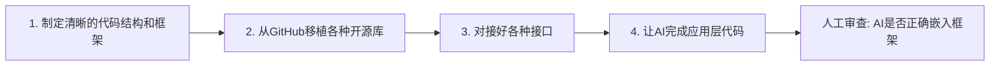

# AI辅助编程实战指南 - 第一讲

> **版权所属:** 物理创新实验室 - 温昊霖
> **课程定位:** 实战为主,原理为辅,注重使用而非底层实现

---

## 📚 课程概述

本课程聚焦于**AI工具的实战应用**,不深入讲解原理,而是教你如何高效使用AI进行辅助编程。

---

## 1️⃣ 市场主流AI工具概览

> 💭 **我的理解**:
> AI工具的发展就像从"傻瓜相机"进化到"专业单反"。Cursor这类AI IDE就像傻瓜相机,开箱即用但功能受限;而CLI工具则像专业单反,需要一定学习成本,但能发挥AI的全部潜力。这个趋势说明了一个事实——**真正想掌控AI的开发者,都在追求更纯粹、更可控的工具链**。

### 🔄 从Cursor到CLI的发展历程

- **2025年初**: Cursor等AI IDE开始流行
- **现阶段**: 各种CLI工具涌现,成为新趋势

### 🤔 什么是CLI?

**CLI (Command Line Interface)** 是一个平台,它可以:

- 嵌入各种不同的AI模型
- 通过命令行方式与AI交互
- 比图形界面更灵活、更强大

---

## 2️⃣ API接入与配置

> 💭 **我的理解**:
> API就像是"外卖点餐系统"。API URL是餐厅地址,API Key是你的会员卡号,API调用就是下单过程。你不需要知道餐厅后厨怎么做菜(AI模型内部原理),只需要知道怎么点餐(调用API)就能吃到美食(获得AI响应)。**掌握API配置,就等于拿到了直接与AI对话的钥匙**,而不是通过第三方平台的"转述"。

### 🔑 核心概念

| 概念 | 说明 |
|------|------|
| **API** | 应用程序接口,让你的程序能调用AI服务 |
| **API Key** | 访问AI服务的密钥,类似于你的账户密码 |
| **API URL** | AI服务的访问地址,告诉程序去哪里请求AI |

### 🌐 主流平台API示例

- **智谱AI (GLM)**: https://bigmodel.cn/
- **OpenAI**: https://api.openai.com/
- **Anthropic (Claude)**: https://api.anthropic.com/

---

## 3️⃣ 各AI模型的核心区别

> 💭 **我的理解**:
> 选AI模型就像组队打游戏。上下文长度就是队友的"视野范围"——视野越广,越能看清全局,做出更合理的决策。至于"聪不聪明",就像队友的技术水平,用几局就知道了。**不要迷信参数,实战体验才是硬道理**。Claude 4.5在代码任务上的表现确实强悍,但GLM-4.5性价比高,适合大量调用。根据项目预算和任务难度灵活选择,才是明智之举。

### 🧠 上下文长度 = AI的"工作记忆"

上下文长度可以理解为**AI的短期记忆容量**:
- 上下文越长,AI能记住的对话内容越多
- 适合处理更复杂、更长的代码文件
- 就像人的工作记忆,决定了同时能处理多少信息

### 🏆 当前模型能力排行 (2025年)

| 排名 | 模型名称 | 特点 |
|------|---------|------|
| 🥇 | **Claude 4.5** | 综合能力最强,代码理解和生成能力突出 |
| 🥈 | **Claude 4.0** / **GPT-5** / **Codex** | 次强梯队,各有侧重 |
| 🥉 | **Gemini 2.5 Pro** / **GLM-4.5** | 新兴强力模型,性价比高 |

> **💡 选择建议**: 聪不聪明你用几次就会有心理预期,根据任务难度选择合适的模型

---

## 4️⃣ 提示词(Prompt)工程

> 💭 **我的理解**:
> 提示词就是给AI定"人设"和"工作规范"。就像你雇了个助手,不告诉他你的工作习惯和要求,他只能按自己的想法干活。但如果你给他一份详细的《工作手册》,明确告诉他"代码要加中文注释"、"遵循PEP8规范"等,他就能完美契合你的需求。**好的提示词能让AI的输出质量提升50%以上**,这是最低成本、最高回报的优化手段。

### 🎯 什么是提示词?

提示词就是**你给AI的指令和约束**,类似于给助手的工作手册。

### 📝 提示词示例

```markdown
# 我的AI助手初始化配置 (/init)

你是一个经验丰富的Python开发者,请遵循以下规则:
1. 代码必须包含详细的中文注释
2. 遵循PEP8编码规范
3. 优先使用类型提示
4. 每个函数都要有docstring
```

### ✨ 提示词的作用

- **提升执行精度**: 让AI更准确理解你的需求
- **统一输出格式**: 保持代码风格一致
- **减少反复沟通**: 一次配置,长期使用

---

## 5️⃣ 为什么选择CLI而非AI IDE?

> 💭 **我的理解**:
> 这就像自己做饭 vs 叫外卖的区别。AI IDE是外卖平台——方便快捷,但平台会抽成(Token消耗高),口味可能被调整(API降智),菜品有限(功能受限)。而CLI是自己买菜做饭——成本更低,食材新鲜,想怎么做就怎么做。**对于想要长期、深度使用AI的开发者来说,CLI是必然选择**。就像我现在作为Claude Code在CLI环境下运行,没有中间商赚差价,给你的都是最纯粹的AI能力。

### 🆚 CLI vs AI IDE 对比

| 对比维度 | CLI模式 | AI IDE |
|---------|---------|--------|
| **Token消耗** | 更少,无内置提示词消耗 | 更多,IDE内嵌大量提示词 |
| **API纯净度** | 直接调用原生API,避免降智 | 可能经过平台二次处理 |
| **灵活性** | 无IDE层面限制,自由度高 | 受IDE功能限制 |
| **适用人群** | 有AI经验的开发者 | 新手友好,但天花板低 |

### ✅ 选择CLI的三大理由

1. **节约成本**: 减少不必要的Token消耗
2. **原汁原味**: 原生API响应,避免平台降智
3. **极致自由**: 无IDE限制,适合高级用户

---

## 6️⃣ AI Agent与MCP工具链

> 💭 **我的理解**:
> Agent就是"有手有脚"的AI。普通AI只能"动嘴"(生成文本),而Agent可以"动手"(执行操作)。MCP就是给AI装上的"工具包"——搜索工具让AI能上网查资料,代码执行工具让AI能跑程序,文件工具让AI能读写文件。**这就是为什么我(Claude Code)能帮你直接修改代码文件,而不只是给你建议**。理解Agent的关键是:**把复杂任务拆解成清晰的步骤**,就像给工人下达详细的施工图,而不是说"给我盖个房子"。

### 🤖 什么是AI Agent?

**Agent** = 能自主执行多步骤任务的AI系统

### 📦 MCP是什么?

**MCP (Model Context Protocol)** = **AI的工具箱**
- 让AI能调用外部工具(搜索、执行代码、访问文件等)
- 扩展AI的能力边界

### 💼 如何用Agent完成项目?

#### 📋 正确的提问思路

```
❌ 错误示范: "帮我写一个网站"
✅ 正确示范:
   1. 我需要一个用户管理系统
   2. 需要实现注册、登录、权限管理三个功能
   3. 使用Flask框架,PostgreSQL数据库
   4. 先帮我设计数据库表结构
   5. 然后实现注册功能的API
   6. ...
```

#### 🔄 Agent工作流程

```
你的需求 → Agent分解任务 → 调用MCP工具 → 执行具体操作 → 返回结果
```

---

## 7️⃣ 拥抱AI时代的正确心态

> 💭 **我的理解**:
> 这段话说出了很多人不敢说的真相。网上总有人鼓吹"必须手搓底层才算真本事",但现实是——**工业界需要的是能解决问题的人,而不是炫技的人**。就像现在没人要求你手写汇编才能当程序员一样,未来也不会要求你手写所有底层代码。AI时代的核心竞争力是:**知道该用什么工具,知道怎么用,知道怎么验证结果**。与其焦虑环境,不如踏实学好AI工具,这才是理性的选择。记住:**做出来>完美主义,结果>过程**。

### 🚫 不要抗拒AI,不要对自己太苛刻

#### 💭 为什么要拥抱AI?

- **底层代码**: 以后大部分不需要手写
- **学习能力**: AI的学习速度永远比我们快
- **结果导向**: 做不出东西,谈何"学会"?

#### 🌍 关于"草台班子"的真相

> 这个世界本来就是一个草台班子。
> **不需要**手搓协议、手搓底层才能找到工作。

| 环境好 | 环境不好 |
|-------|---------|
| 大部分人都能找到好工作 | 大部分人都找不到好工作 |

**结论**: 大环境影响远大于个人努力,本科期间**不该焦虑大环境**,只需踏踏实实进步。

---

## 8️⃣ 正确的AI辅助编程思路

> 💭 **我的理解**:
> 这套四步法是**人机协作的黄金法则**。很多人用AI失败,是因为完全放手让AI干所有事——结果AI不懂项目架构,乱写一通。正确做法是:**人负责战略(架构设计、技术选型、接口对接),AI负责战术(具体实现、重复劳动)**。就像你是项目经理,AI是码农——你得画好施工图,AI才能砌好砖。最关键的是第4步的**人工审查**,这是质量保障的最后一道防线。永远记住:**AI是助手,不是替代品;你是架构师,不是甩手掌柜**。

### 🎭 角色定位: AI = 资深程序员助手

把AI当作一个**技术很强,但不知道要干嘛的资深程序员**。

### 📊 工作流程四步法



#### 🔢 详细步骤

| 步骤 | 你的任务 | AI的任务 |
|-----|---------|---------|
| **1** | 设计清晰的代码结构和框架/准备好实现使用的技术栈 | - |
| **2** | 从GitHub下载并移植各种库 | - |
| **3** | 对接好各种接口 | - |
| **4** | 审查AI生成的代码位置是否正确 | 完成应用层具体实现 |

### 📈 效率提升关键

✅ **一件件传递任务**: 不要一次性给AI太复杂的需求
✅ **明确验收标准**: 告诉AI什么样算"完成"
✅ **人工把关**: 检查AI是否把框架嵌入了正确的位置

---

## 9️⃣ 行业趋势与求职加分项

> 💭 **我的理解**:
> 这不是趋势,这已经是**现实**。我见过太多招聘JD上写着"熟悉AI辅助开发工具者优先"。企业很清楚——**会用AI的开发者,效率能吊打传统开发者**。但注意,这里说的是"会用",不是"会调用"。简单调个API谁都会,关键是:**能否通过AI快速实现复杂功能?能否用提示词精确控制AI输出?能否在AI生成的代码基础上高效调试优化?** 这些才是真正的加分项。所以不要藏着掖着,大大方方在简历上写,在面试中展示,这是你的竞争优势。

### 💼 企业对AI能力的认可

> **已有大量公司**将"使用AI辅助编程能力"列为**简历加分项**

#### 📝 简历中可以这样写

```markdown
技能亮点:
- 熟练使用Claude/GPT等AI工具进行代码生成和调试
- 掌握Prompt工程,能高效引导AI完成复杂任务
- 使用AI辅助完成XX项目,开发效率提升XX%
```

---

## 🎯 课程总结

> 💭 **我的理解**:
> 这节课的核心其实就一句话:**学会用工具,而不是被工具替代**。AI时代不是"人会被淘汰",而是"不会用AI的人会被淘汰"。我们要做的是:**掌握AI这个超级工具,用它来放大自己的能力**。记住三个关键词——**工具(CLI/API)**、**心态(拥抱/务实)**、**方法(提示词/四步法)**。掌握这些,你就能在AI时代游刃有余。最后再强调一次:**AI是助手,你才是主角**。

### 🔑 核心要点

1. **工具选择**: CLI > AI IDE (对于有经验的开发者)
2. **模型选择**: 根据任务难度选择合适模型
3. **正确心态**: 拥抱AI,结果为导向
4. **工作流程**: 你负责架构设计,AI负责实现细节
5. **职业发展**: AI辅助能力已成企业认可的加分项

### 💡 一句话总结

> **不要害怕使用AI,也不要盲目依赖AI。**
> **让AI成为你的助手,而不是替代品。**

---

**版权所有 © 2025 物理创新实验室 - 温昊霖**
