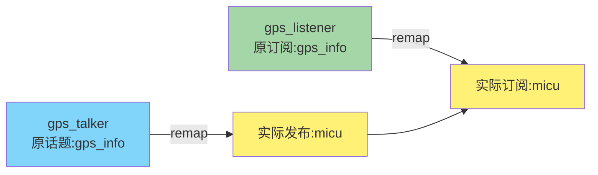

# 🚀 ROS Launch文件详解

> 🎯 **核心概念**：Launch文件是ROS中用于一次性启动多个节点的XML配置文件,简化复杂系统的启动流程

---

## 🔄 Launch文件特点

| 特性 | 说明 | 优势 |
|------|------|------|
| **批量启动** | 一次性启动多个节点 | 避免逐个启动节点的繁琐操作 |
| **参数配置** | 统一配置节点参数 | 集中管理系统配置 |
| **XML格式** | 使用XML语法编写 | 结构清晰,易于维护 |
| **层级组织** | 支持include和命名空间 | 便于模块化管理 |

---

## 📋 基本结构

### Launch文件的基本语法

所有内容都必须包含在`<launch>`标签中:

```xml
<launch>
    <!-- 所有节点和配置都写在这里 -->
</launch>
```

---

## 🔧 核心标签:`<node>`

### 基本语法

```xml
<node pkg="包名" type="可执行文件名" name="节点名称" />
```

### 参数说明

| 属性 | 必填 | 说明 | 示例 |
|------|------|------|------|
| `pkg` | ✅ | ROS包名 | `"topic_demo_pkg"` |
| `type` | ✅ | 可执行文件名称 | `"gps_talker"` |
| `name` | ✅ | 运行时节点名称 | `"gps_talker_node"` |
| `output` | ❌ | 输出位置 | `"screen"` 或 `"log"` |
| `respawn` | ❌ | 节点崩溃后是否重启 | `"true"` 或 `"false"` |
| `required` | ❌ | 节点关闭时是否关闭整个launch | `"true"` 或 `"false"` |

---

## 💻 type参数详解

### C++可执行文件名称

**如何确定`type`的值?**

在`CMakeLists.txt`中查找`add_executable`:

```cmake
add_executable(gps_listener src/gps_listener.cpp)
#              ↑
#          这就是type的值
```

**示例:**

```xml
<node pkg="topic_demo_pkg" type="gps_listener" name="gps_listener" />
<!--                            ↑                                   -->
<!--                    CMakeLists.txt中定义的可执行文件名           -->
```

---

### Python脚本文件名称

**Python的`type`直接使用文件名:**

```xml
<node pkg="topic_demo_pkg" type="gps_talker.py" name="gps_talker" />
<!--                            ↑                                  -->
<!--                    Python脚本文件名(包含.py后缀)               -->
```

⚠️ **注意**:
- Python脚本需要添加执行权限: `chmod +x gps_talker.py`
- 脚本第一行需要添加: `#!/usr/bin/env python3`

---

## 📝 完整示例

### 示例1: GPS发布者和订阅者

```xml
<launch>
    <!-- GPS发布者节点 -->
    <node pkg="topic_demo_pkg" type="gps_talker" name="gps_talker" />

    <!-- GPS订阅者节点 (输出到终端) -->
    <node pkg="topic_demo_pkg" type="gps_listener" name="gps_listener" output="screen" />
</launch>
```

**说明:**
- 启动两个节点:`gps_talker`和`gps_listener`
- `gps_listener`的输出显示在终端(通过`output="screen"`)
- `gps_talker`的输出记录在日志文件(未指定`output`)

---

## 🎛️ 常用属性详解

### 1. `output` - 输出位置

控制节点日志的输出位置:

```xml
<!-- 输出到终端 -->
<node pkg="pkg_name" type="node_type" name="node_name" output="screen" />

<!-- 输出到日志文件(默认) -->
<node pkg="pkg_name" type="node_type" name="node_name" output="log" />

<!-- 不指定output,默认输出到日志 -->
<node pkg="pkg_name" type="node_type" name="node_name" />
```

**对比:**

| 设置 | 效果 | 适用场景 |
|------|------|----------|
| `output="screen"` | 终端显示日志 | 开发调试,需要实时查看输出 |
| `output="log"` 或不设置 | 日志文件记录 | 生产环境,后台运行 |

---

### 2. `respawn` - 自动重启

节点意外崩溃后是否自动重启:

```xml
<!-- 崩溃后自动重启 -->
<node pkg="pkg_name" type="node_type" name="node_name" respawn="true" />

<!-- 崩溃后不重启(默认) -->
<node pkg="pkg_name" type="node_type" name="node_name" respawn="false" />
```

**使用场景:**

| 设置 | 适用场景 |
|------|----------|
| `respawn="true"` | 核心节点,需要保持运行(如传感器驱动) |
| `respawn="false"` | 一次性任务节点,调试阶段 |

**高级参数:**

```xml
<!-- 延迟重启 -->
<node pkg="pkg_name" type="node_type" name="node_name"
      respawn="true"
      respawn_delay="5" />
<!-- 崩溃后等待5秒再重启 -->
```

---

### 3. `required` - 关键节点标记

标记为`required`的节点关闭时,整个launch文件中的所有节点都会关闭:

```xml
<!-- 关键节点,关闭后终止整个系统 -->
<node pkg="pkg_name" type="node_type" name="node_name" required="true" />

<!-- 普通节点(默认) -->
<node pkg="pkg_name" type="node_type" name="node_name" required="false" />
```

**使用场景:**

```xml
<launch>
    <!-- ROS Master必须运行,如果关闭则终止所有节点 -->
    <node pkg="roscore" type="roscore" name="roscore" required="true" />

    <!-- 普通传感器节点 -->
    <node pkg="sensor_pkg" type="camera_node" name="camera" />
</launch>
```

---

### 4. `<remap>` - 话题重映射

**重映射(Remap)**用于将节点内部的话题名称映射到不同的话题名称,实现话题名称的统一管理。

#### 基本语法

```xml
<node pkg="pkg_name" type="node_type" name="node_name">
    <remap from="原话题名" to="新话题名" />
</node>
```

#### 实际示例: GPS发布者和订阅者重映射

**场景**: 将`gps_talker`和`gps_listener`的话题都重映射为`micu`

```xml
<launch>
    <!-- GPS发布者: 将发布话题从"gps_info"重映射为"micu" -->
    <node pkg="topic_demo_pkg" type="gps_talker" name="gps_talker">
        <remap from="gps_info" to="micu" />
    </node>

    <!-- GPS订阅者: 将订阅话题从"gps_info"重映射为"micu" -->
    <node pkg="topic_demo_pkg" type="gps_listener" name="gps_listener" output="screen">
        <remap from="gps_info" to="micu" />
    </node>
</launch>
```

**工作原理:**



**效果:**
- `gps_talker`原本发布到`gps_info`话题,现在发布到`micu`话题
- `gps_listener`原本订阅`gps_info`话题,现在订阅`micu`话题
- 两个节点通过`micu`话题通信,无需修改源代码

#### 重映射的应用场景

**场景1: 统一话题名称**

```xml
<launch>
    <!-- 多个传感器节点使用统一的话题名称 -->
    <node pkg="camera_pkg" type="camera_driver" name="camera_front">
        <remap from="image" to="/sensors/camera/front" />
    </node>

    <node pkg="camera_pkg" type="camera_driver" name="camera_back">
        <remap from="image" to="/sensors/camera/back" />
    </node>
</launch>
```

**场景2: 避免话题名称冲突**

```xml
<launch>
    <!-- 启动两个相同的节点,但使用不同的话题 -->
    <node pkg="sensor_pkg" type="sensor_node" name="sensor_1">
        <remap from="data" to="sensor_1/data" />
    </node>

    <node pkg="sensor_pkg" type="sensor_node" name="sensor_2">
        <remap from="data" to="sensor_2/data" />
    </node>
</launch>
```

**场景3: 连接不同节点**

```xml
<launch>
    <!-- 将节点A的输出连接到节点B的输入 -->
    <node pkg="pkg_a" type="node_a" name="producer">
        <remap from="output" to="data_stream" />
    </node>

    <node pkg="pkg_b" type="node_b" name="consumer">
        <remap from="input" to="data_stream" />
    </node>
</launch>
```

#### 重映射语法对比

| 语法类型 | 示例 | 说明 |
|---------|------|------|
| **标签内重映射** | `<node><remap from="a" to="b"/></node>` | 只影响该节点 |
| **属性重映射** | `<node args="a:=b" />` | 命令行风格(不推荐) |
| **全局重映射** | `<remap from="a" to="b"/>` | 影响所有节点 |

**推荐使用**: 标签内重映射,作用域清晰,易于维护

#### 验证重映射效果

```bash
# 启动launch文件
roslaunch topic_demo_pkg gps_demo.launch

# 查看活动话题列表
rostopic list
# 应该看到 /micu 而不是 /gps_info

# 查看话题信息
rostopic info /micu
# 应该显示 gps_talker 发布, gps_listener 订阅

# 实时查看话题数据
rostopic echo /micu
```

---

## 🔧 其他常用标签

### `<param>` - 设置参数

```xml
<launch>
    <!-- 设置参数 -->
    <param name="robot_name" value="micu_robot" />
    <param name="max_speed" value="1.5" />

    <node pkg="pkg_name" type="node_type" name="node_name" />
</launch>
```

---

### `<rosparam>` - 加载YAML参数文件

```xml
<launch>
    <!-- 加载YAML参数文件 -->
    <rosparam file="$(find pkg_name)/config/params.yaml" command="load" />

    <node pkg="pkg_name" type="node_type" name="node_name" />
</launch>
```

---

### `<include>` - 包含其他launch文件

```xml
<launch>
    <!-- 包含其他launch文件 -->
    <include file="$(find pkg_name)/launch/sensors.launch" />

    <node pkg="pkg_name" type="node_type" name="node_name" />
</launch>
```

---

### `<arg>` - 定义参数

```xml
<launch>
    <!-- 定义可传递的参数 -->
    <arg name="use_sim" default="false" />

    <!-- 根据参数条件启动节点 -->
    <node if="$(arg use_sim)" pkg="sim_pkg" type="simulator" name="sim" />
</launch>
```

**使用方法:**

```bash
# 使用默认值
roslaunch pkg_name launch_file.launch

# 传递参数
roslaunch pkg_name launch_file.launch use_sim:=true
```

---

## 📊 完整示例集合

### 示例1: 基础多节点启动

```xml
<launch>
    <!-- 启动发布者 -->
    <node pkg="topic_demo_pkg" type="gps_talker" name="gps_talker" />

    <!-- 启动订阅者,输出到终端 -->
    <node pkg="topic_demo_pkg" type="gps_listener" name="gps_listener" output="screen" />
</launch>
```

---

### 示例2: 带参数和重启功能

```xml
<launch>
    <!-- 设置全局参数 -->
    <param name="robot_name" value="micu_robot" />

    <!-- 核心节点,崩溃后自动重启 -->
    <node pkg="sensor_pkg" type="lidar_driver" name="lidar"
          output="screen"
          respawn="true"
          respawn_delay="3" />

    <!-- 关键节点,关闭后终止整个系统 -->
    <node pkg="navigation_pkg" type="nav_core" name="navigation"
          output="screen"
          required="true" />
</launch>
```

---

### 示例3: 加载配置文件

```xml
<launch>
    <!-- 加载YAML参数配置 -->
    <rosparam file="$(find my_pkg)/config/robot_params.yaml" command="load" />

    <!-- 启动多个节点 -->
    <node pkg="my_pkg" type="controller" name="controller" output="screen" />
    <node pkg="my_pkg" type="planner" name="planner" output="screen" />
</launch>
```

---

### 示例4: 条件启动节点

```xml
<launch>
    <!-- 定义参数 -->
    <arg name="use_camera" default="true" />
    <arg name="use_lidar" default="false" />

    <!-- 条件启动摄像头 -->
    <node if="$(arg use_camera)"
          pkg="camera_pkg" type="camera_driver" name="camera"
          output="screen" />

    <!-- 条件启动激光雷达 -->
    <node if="$(arg use_lidar)"
          pkg="lidar_pkg" type="lidar_driver" name="lidar"
          output="screen" />
</launch>
```

**运行方式:**

```bash
# 只启动摄像头(默认)
roslaunch my_pkg my_launch.launch

# 只启动激光雷达
roslaunch my_pkg my_launch.launch use_camera:=false use_lidar:=true

# 同时启动两者
roslaunch my_pkg my_launch.launch use_camera:=true use_lidar:=true
```

---

## 💡 使用要点

### ✅ 最佳实践

- **命名规范**: launch文件使用小写字母和下划线,如`start_navigation.launch`
- **输出管理**: 调试时使用`output="screen"`,生产环境使用默认日志
- **模块化**: 将大型系统拆分成多个launch文件,使用`<include>`组合
- **参数外置**: 使用YAML文件管理参数,便于修改和版本控制

### ❗ 注意事项

- **节点名称唯一**: 同一launch中节点`name`不能重复
- **Python权限**: Python脚本需要可执行权限(`chmod +x`)
- **路径问题**: 使用`$(find pkg_name)`而不是硬编码路径
- **respawn谨慎**: 避免对有问题的节点设置`respawn="true"`,会导致无限重启

### ✅ 调试技巧

```bash
# 检查launch文件语法
roslaunch --check my_pkg my_launch.launch

# 查看launch文件将启动哪些节点(不实际启动)
roslaunch --nodes my_pkg my_launch.launch

# 查看启动的节点列表
rosnode list

# 查看节点详细信息
rosnode info /node_name
```

---

## 📝 常用命令

| 命令 | 功能 | 示例 |
|------|------|------|
| `roslaunch pkg_name launch_file.launch` | 启动launch文件 | `roslaunch topic_demo_pkg gps_demo.launch` |
| `roslaunch --check launch_file.launch` | 检查launch文件语法 | `roslaunch --check gps_demo.launch` |
| `roslaunch --nodes launch_file.launch` | 列出将启动的节点 | `roslaunch --nodes gps_demo.launch` |
| `roslaunch pkg_name file.launch arg:=value` | 传递参数启动 | `roslaunch my_pkg demo.launch use_sim:=true` |

---

<div align="center">

**📖 米醋电子工作室 | KimJong 版权所有**

</div>


<param name="">

