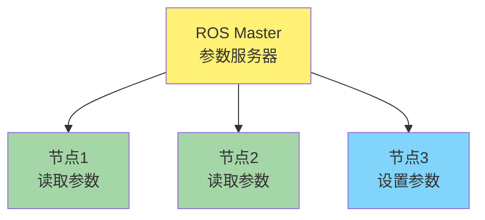
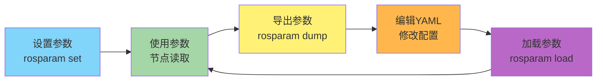
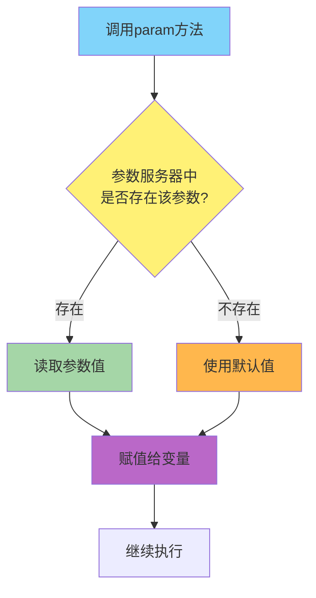

# 🗄️ ROS 参数服务器 (Parameter Server) 详解

> 🎯 **核心概念**：ROS中的全局变量存储系统,用于在节点间共享配置参数,所有参数注册在ROS Master上

---

## 🔄 参数服务器特点

| 特性 | 说明 | 应用场景 |
|------|------|----------|
| **全局共享** | 所有节点都可以访问参数 | 全局配置管理 |
| **集中管理** | 参数统一存储在ROS Master | 参数集中配置 |
| **动态修改** | 运行时可以修改参数值 | 实时参数调整 |
| **持久化存储** | 支持YAML文件导入导出 | 配置文件管理 |

---

## 📋 基本概念

### 什么是参数服务器?

参数服务器相当于**ROS中的全局变量存储系统**:



**核心特点:**
- ✅ 注册在ROS Master上
- ✅ 所有节点共享访问
- ✅ 支持运行时修改
- ⚠️ 命令行设置不会永久保存

---

## 📝 常用命令

### 1. 列出所有参数

```bash
rosparam list
```

**示例输出:**

```bash
/micu
/rosdistro
/roslaunch/uris/host_ubuntu20__37597
/rosversion
/run_id
```

---

### 2. 设置参数

```bash
rosparam set <键名> <值>
```

**示例:**

```bash
# 设置参数 micu 的值为 123
rosparam set /micu 123
```

⚠️ **注意**: 命令行设置的参数**不是永久的**,节点重启后会丢失

---

### 3. 获取参数

```bash
rosparam get <键名>
```

**示例:**

```bash
# 查看参数 micu 的值
rosparam get /micu
# 输出: 123
```

**常见拼写错误提醒:**
- ❌ `rosparam gry` (错误)
- ✅ `rosparam get` (正确)

---

### 4. 删除参数

```bash
rosparam delete <键名>
```

**示例:**

```bash
rosparam delete /micu
```

---

## 💾 参数持久化存储

### 导出参数到YAML文件

将当前所有参数保存到YAML文件中:

```bash
rosparam dump <文件名.yaml>
```

**示例:**

```bash
# 导出所有参数到 test.yaml
rosparam dump test.yaml
```

**生成的 test.yaml 文件内容:**

```yaml
rosdistro: 'noetic'
roslaunch:
  uris:
    host_ubuntu20__37597: http://ubuntu20:37597/
rosversion: '1.17.4'
run_id: 56b7e3c0-bacd-11f0-b412-f118111dbca5
micu: 123
```

---

### 从YAML文件加载参数

从YAML文件中导入参数到参数服务器:

```bash
rosparam load <文件名.yaml>
```

**示例:**

```bash
# 从 test.yaml 加载参数
rosparam load test.yaml
```

**加载后验证:**

```bash
rosparam list
```

**输出:**

```bash
/micu
/rosdistro
/roslaunch/uris/host_ubuntu20__37597
/rosversion
/run_id
```

---

## 🔄 参数管理工作流程



---

## 📊 命令速查表

| 命令 | 功能 | 示例 |
|------|------|------|
| `rosparam list` | 列出所有参数 | `rosparam list` |
| `rosparam set <key> <value>` | 设置参数值 | `rosparam set /micu 123` |
| `rosparam get <key>` | 获取参数值 | `rosparam get /micu` |
| `rosparam delete <key>` | 删除参数 | `rosparam delete /micu` |
| `rosparam dump <file.yaml>` | 导出参数到文件 | `rosparam dump test.yaml` |
| `rosparam load <file.yaml>` | 从文件加载参数 | `rosparam load test.yaml` |

---

## 💡 使用要点

### ✅ 最佳实践

- **参数命名规范**: 使用`/`开头的绝对路径,如`/robot_name`
- **YAML配置管理**: 重要参数使用YAML文件管理,便于版本控制
- **Launch文件加载**: 在launch文件中自动加载参数,避免手动操作
- **参数分组**: 使用命名空间对参数进行逻辑分组

### ❗ 注意事项

- **临时性**: 命令行设置的参数不会永久保存,重启后丢失
- **类型转换**: 参数值会自动进行类型推断(数字、字符串、布尔值等)
- **覆盖问题**: 重复加载YAML会覆盖现有参数值
- **节点启动顺序**: 确保参数在节点使用前已加载

### ✅ 推荐工作方式

1. **开发阶段**: 使用`rosparam set`快速测试参数
2. **配置完成**: 使用`rosparam dump`导出到YAML文件
3. **生产环境**: 在launch文件中使用`rosparam load`自动加载配置

---

## 💻 代码实现

### C++实现 - 从参数服务器加载参数

#### 🔄 流程与思路

1. **创建节点句柄**：创建`ros::NodeHandle`对象访问参数服务器
2. **使用param()方法**：使用`param<类型>(参数名, 变量, 默认值)`读取参数
3. **类型安全**：通过模板参数指定参数类型
4. **默认值机制**：如果参数不存在,使用提供的默认值

#### 完整代码示例

```cpp
#include "ros/ros.h"
#include <string>

int main(int argc, char** argv)
{
    // 初始化ROS节点
    ros::init(argc, argv, "param_demo_node");

    // 创建私有节点句柄(用于访问私有参数)
    ros::NodeHandle private_nh("~");

    // 声明变量用于存储参数
    std::string usart_port_name;
    int serial_baud_rate;
    std::string odom_frame_id;
    std::string robot_frame_id;
    std::string gyro_frame_id;
    float odom_x_scale;
    float odom_y_scale;
    float odom_z_scale_positive;
    float odom_z_scale_negative;

    // 从ROS参数服务器加载参数
    // 语法: param<类型>("参数名", 变量, 默认值)
    private_nh.param<std::string>("usart_port_name", usart_port_name, "/dev/ttyACM0");
    private_nh.param<int>("serial_baud_rate", serial_baud_rate, 115200);
    private_nh.param<std::string>("odom_frame_id", odom_frame_id, "odom_combined");
    private_nh.param<std::string>("robot_frame_id", robot_frame_id, "base_footprint");
    private_nh.param<std::string>("gyro_frame_id", gyro_frame_id, "gyro_link");
    private_nh.param<float>("odom_x_scale", odom_x_scale, 1.0);
    private_nh.param<float>("odom_y_scale", odom_y_scale, 1.0);
    private_nh.param<float>("odom_z_scale_positive", odom_z_scale_positive, 1.0);
    private_nh.param<float>("odom_z_scale_negative", odom_z_scale_negative, 1.0);

    // 打印加载的参数
    ROS_INFO("串口名称: %s", usart_port_name.c_str());
    ROS_INFO("波特率: %d", serial_baud_rate);
    ROS_INFO("里程计坐标系: %s", odom_frame_id.c_str());
    ROS_INFO("机器人坐标系: %s", robot_frame_id.c_str());
    ROS_INFO("陀螺仪坐标系: %s", gyro_frame_id.c_str());
    ROS_INFO("X轴缩放: %.2f", odom_x_scale);
    ROS_INFO("Y轴缩放: %.2f", odom_y_scale);

    return 0;
}
```

#### param()方法详解

**函数原型:**

```cpp
template<typename T>
void param(const std::string& param_name, T& param_val, const T& default_val);
```

**参数说明:**

| 参数 | 类型 | 说明 |
|------|------|------|
| `param_name` | `const std::string&` | 参数名称 |
| `param_val` | `T&` | 用于存储参数值的变量(引用) |
| `default_val` | `const T&` | 参数不存在时使用的默认值 |

**工作流程:**



**支持的数据类型:**

```cpp
// 字符串类型
private_nh.param<std::string>("param_name", str_var, "default_value");

// 整数类型
private_nh.param<int>("param_name", int_var, 100);

// 浮点类型
private_nh.param<float>("param_name", float_var, 1.0);
private_nh.param<double>("param_name", double_var, 1.0);

// 布尔类型
private_nh.param<bool>("param_name", bool_var, true);
```

---

### Python实现 (简化版)

#### 核心代码

```python
#!/usr/bin/env python3
import rospy

def load_parameters():
    # 初始化节点
    rospy.init_node("param_demo_node")

    # 从参数服务器读取参数
    # 语法: rospy.get_param("参数名", 默认值)
    usart_port_name = rospy.get_param("~usart_port_name", "/dev/ttyACM0")
    serial_baud_rate = rospy.get_param("~serial_baud_rate", 115200)
    odom_frame_id = rospy.get_param("~odom_frame_id", "odom_combined")
    robot_frame_id = rospy.get_param("~robot_frame_id", "base_footprint")
    odom_x_scale = rospy.get_param("~odom_x_scale", 1.0)
    odom_y_scale = rospy.get_param("~odom_y_scale", 1.0)

    # 打印参数
    rospy.loginfo(f"串口名称: {usart_port_name}")
    rospy.loginfo(f"波特率: {serial_baud_rate}")
    rospy.loginfo(f"里程计坐标系: {odom_frame_id}")
    rospy.loginfo(f"X轴缩放: {odom_x_scale}")

if __name__ == "__main__":
    load_parameters()
```

**关键函数:**

| 函数 | 功能 | 示例 |
|------|------|------|
| `rospy.get_param(name, default)` | 获取参数,带默认值 | `rospy.get_param("~port", "/dev/ttyACM0")` |
| `rospy.set_param(name, value)` | 设置参数 | `rospy.set_param("~speed", 1.5)` |
| `rospy.has_param(name)` | 检查参数是否存在 | `rospy.has_param("~port")` |
| `rospy.delete_param(name)` | 删除参数 | `rospy.delete_param("~temp")` |

**参数命名空间:**

- `~param_name` - 私有参数(节点名称空间)
- `param_name` - 相对参数(当前命名空间)
- `/param_name` - 全局参数(根命名空间)

---

## 🚀 Launch文件中使用参数

### 加载YAML文件

```xml
<launch>
    <!-- 加载参数配置文件 -->
    <rosparam file="$(find your_package)/config/params.yaml" command="load"/>

    <!-- 启动节点 -->
    <node name="my_node" pkg="your_package" type="my_node"/>
</launch>
```

### 直接设置参数

```xml
<launch>
    <!-- 直接在launch文件中设置参数 -->
    <param name="robot_name" value="micu_robot"/>
    <param name="max_speed" value="1.5"/>
    <param name="debug_mode" value="true"/>
</launch>
```

---

<div align="center">

**📖 米醋电子工作室 | KimJong 版权所有**

</div>