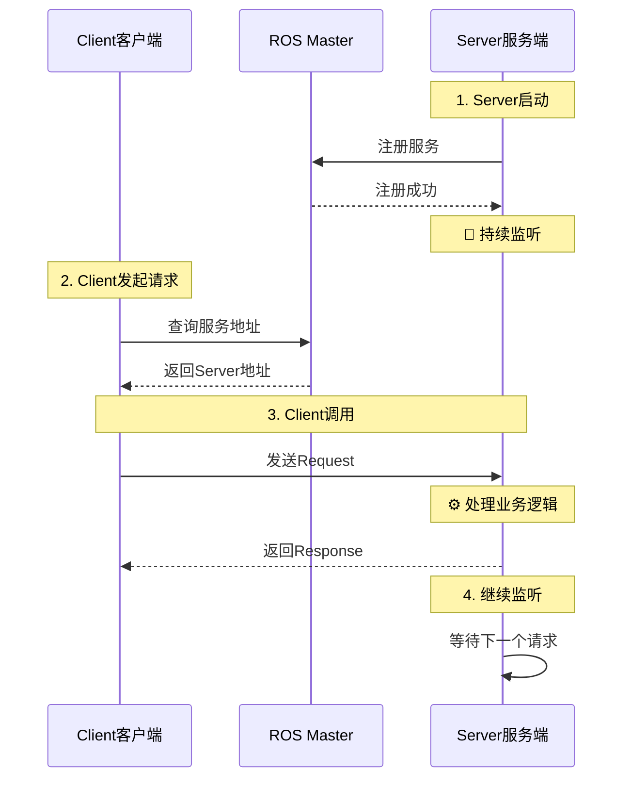
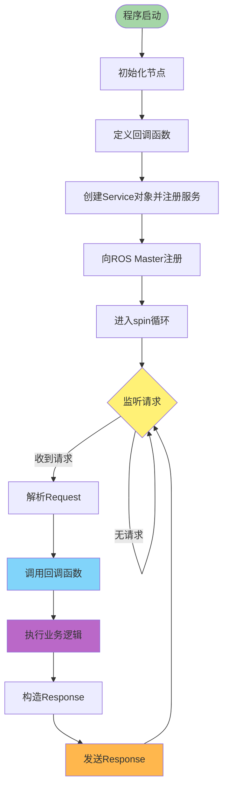
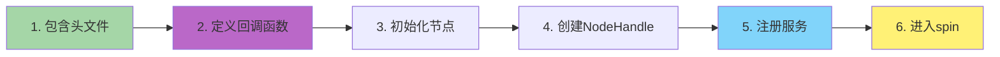
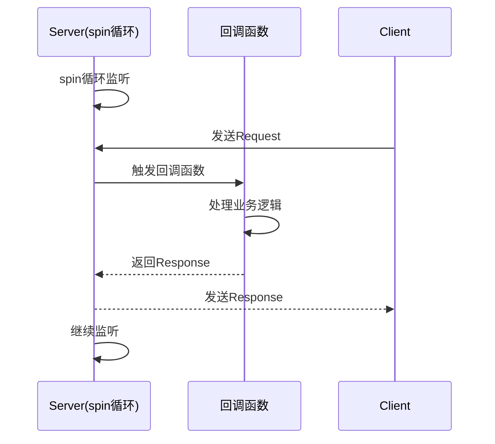
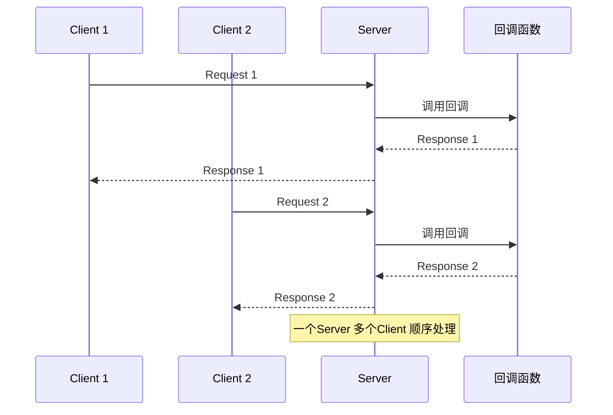

# 📥 ROS Service Server (服务端) 详解

**版权所属: 米醋电子工作室 | KimJong**

---

## 📋 目录

- [基本概念](#基本概念)
- [工作原理](#工作原理)
- [实现流程](#实现流程)
- [Python实现](#python实现)
- [C++实现](#c实现)
- [常见问题](#常见问题)

---

## 🎯 基本概念

### 什么是Service Server?

Service Server(服务端)是ROS Service通讯机制中的**应答方**,负责:

- 📥 接收请求(Request)
- ⚙️ 处理业务逻辑
- 📤 返回响应(Response)
- 🔄 持续监听新请求

### Server在Service通讯中的角色



---

## 🔧 工作原理

### Server工作机制



### 核心特点

| 特性 | 说明 |
|------|------|
| **持续监听** | Server启动后持续运行,等待请求 |
| **被动响应** | 不主动发送,只在收到请求时响应 |
| **回调机制** | 通过回调函数处理每个请求 |
| **一对多服务** | 一个Server可以服务多个Client |
| **阻塞Client** | 处理时Client会阻塞等待 |

---

## 📝 实现流程

### 编写Server的核心步骤

#### Python实现逻辑 (详见后文简化版)

核心步骤:定义回调 → 初始化节点 → 创建Service → spin循环

#### C++实现逻辑



**详细步骤:**

1. **包含头文件**
   - `#include "ros/ros.h"`
   - `#include "server_demo_pkg/detect_char.h"`

2. **定义回调函数**
   - 函数签名: `bool handle_req(Request& req, Response& resp)`
   - 参数1: Request引用,接收client端请求
   - 参数2: Response引用,返回给client端的响应
   - 返回bool表示是否成功处理

3. **初始化节点**
   - `ros::init(argc, argv, "server_cpp_node")`

4. **创建NodeHandle**
   - `ros::NodeHandle nh`

5. **注册服务**
   - `ros::ServiceServer service = nh.advertiseService("detect", handle_req)`
   - 参数1: 服务名称 `"detect"`
   - 参数2: 回调函数 `handle_req`

6. **进入spin循环**
   - `ros::spin()`
   - 持续监听请求,阻塞在此

---

## 🔷 C++实现

### 完整代码示例

```cpp
/**
 * ROS Service Server 示例 - 字符检测服务端
 * 功能: 接收检测请求,返回检测结果
 * 版权: 米醋电子工作室 | KimJong
 */

#include "ros/ros.h"
#include "server_demo_pkg/detect_char.h"  // 注意:包名应为server_demo_pkg

/**
 * 服务回调函数 - 处理字符检测请求
 *
 * @param req  请求对象(Request),包含detect_flag字段，是client端发送的请求
 * @param resp 响应对象(Response),包含char_type字段，是给client端发的响应
 * @return     返回true表示处理成功,false表示失败
 */
bool handle_req(server_demo_pkg::detect_char::Request &req,
                server_demo_pkg::detect_char::Response &resp)
{
    // 获取请求中的检测标志
    int flag = req.detect_flag;

    // 记录收到的请求
    ROS_INFO("I got request: %d", flag);

    // 业务逻辑处理，也就是传输给client端的
    if (flag != 0)
    {
        // 执行检测
        resp.char_type = "I am server detect micu";
    }
    else
    {
        // 等待检测
        resp.char_type = "I am waiting server detect";
    }

    // 返回true表示成功处理
    return true;
}

int main(int argc, char** argv)
{
    // 1. 初始化ROS节点
    ros::init(argc, argv, "server_cpp_node");

    // 2. 创建节点句柄
    ros::NodeHandle nh;

    // 3. 注册服务
    // 参数1: 服务名称
    // 参数2: 回调函数
    ros::ServiceServer service = nh.advertiseService("detect", handle_req);

    ROS_INFO("检测服务已启动,等待请求...");

    // 4. 进入spin循环,持续监听请求
    ros::spin();

    return 0;
}
```

### C++代码说明

#### 关键API

| API | 功能 | 参数 |
|-----|------|------|
| `nh.advertiseService(name, callback)` | 注册服务 | 服务名、回调函数 |
| `ros::spin()` | 进入循环 | 无 |
| `ROS_INFO()` | 日志输出 | 格式化字符串 |

#### 回调函数要点

**1. 函数签名 (必须遵守)**
```cpp
bool handle_req(server_demo_pkg::detect_char::Request  &req,
                server_demo_pkg::detect_char::Response &resp)
{
    // 处理逻辑
    return true;  // true表示成功,false表示失败
}
```

**2. Request访问 (只读)**
```cpp
// 读取Request字段,获取client端发送的数据
int flag = req.detect_flag;
```

**3. Response设置 (修改)**
```cpp
// 设置Response字段,这些数据将返回给client端
resp.char_type = "I am server detect micu";
```

**4. 返回值含义**
```cpp
return true;   // 处理成功,Response有效
return false;  // 处理失败,Response无效
```

---

## 🐍 Python实现 (简化版)

**核心代码:**

```python
import rospy
from server_demo_pkg.srv import detect_char, detect_charResponse

def handle_detect_request(req):
    """回调函数 - 处理请求并返回响应"""
    if req.detect_flag != 0:
        return detect_charResponse("检测到字符: A")
    else:
        return detect_charResponse("等待检测信号")

if __name__ == "__main__":
    rospy.init_node("server_py_node")
    server = rospy.Service("detect", detect_char, handle_detect_request)
    rospy.loginfo("服务已启动")
    rospy.spin()
```

**关键步骤:**

1. 定义回调函数 `def handle_detect_request(req): return response`
2. 初始化节点 `rospy.init_node()`
3. 创建Service `rospy.Service(name, Type, callback)`
4. 进入spin `rospy.spin()`

---

## ❓ 常见问题

### 1. 回调函数什么时候被调用?



**答:**
- ✅ 当Client调用服务时,ROS自动触发回调
- ✅ 回调函数在Server的线程中执行
- ✅ 回调完成后,Response自动发送给Client

### 2. Server需要主动发送数据吗?

**答: 不需要**

```python
# ❌ 错误理解: Server主动发送
def callback(req):
    resp = SrvTypeResponse("data")
    # 不需要手动发送,只需return
    some_publisher.publish(resp)  # 错误!
    return resp

# ✅ 正确: Server被动响应
def callback(req):
    resp = SrvTypeResponse("data")
    return resp  # ROS会自动发送给Client
```

**Server特点:**
- 🔴 被动响应,不主动发送
- 🔴 只在收到请求时处理
- 🟢 return Response即可,ROS负责发送

### 3. 一个Server可以处理多个Client吗?

**答: 可以**



**注意:**
- ✅ 一个Server可以服务多个Client
- ⚠️ 请求是**串行处理**的,不是并发
- ⚠️ 当处理Client1时,Client2需要等待

### 4. 如果回调函数执行时间很长怎么办?

```python
def slow_callback(req):
    """耗时的回调函数"""
    rospy.loginfo("开始处理...")

    # 模拟耗时操作 (10秒)
    import time
    time.sleep(10)

    rospy.loginfo("处理完成")
    return SrvTypeResponse("done")
```

**问题:**

- ❌ Client会阻塞10秒等待
- ❌ 其他Client也要等待这10秒
- ❌ 可能导致超时

**解决方案:**

- 优化业务逻辑,减少回调函数执行时间
- 对于耗时任务,使用Action代替Service
- 使用后台线程处理,快速返回任务ID

---

## 📝 总结

### Server编程要点

✅ **必做事项:**
1. 定义正确的回调函数签名
2. 在回调中构造并返回Response
3. 使用rospy.spin()持续监听
4. 添加日志记录,便于调试

⚠️ **注意事项:**
1. 回调函数要尽可能快速执行
2. 多个Client的请求是串行处理的
3. 回调函数中避免阻塞操作
4. 异常要妥善处理,避免Server崩溃

### Python vs C++对比

| 方面 | Python | C++ |
|------|--------|-----|
| **回调签名** | `def cb(req): return resp` | `bool cb(req, res)` |
| **Response构造** | `return SrvTypeResponse(value)` | `res.field = value; return true` |
| **服务创建** | `rospy.Service(name, Type, cb)` | `nh.advertiseService(name, cb)` |
| **进入循环** | `rospy.spin()` | `ros::spin()` |
| **日志输出** | `rospy.loginfo()` | `ROS_INFO()` |

### 调试技巧

```python
# 添加详细日志
rospy.loginfo("=" * 50)
rospy.loginfo("收到请求")
rospy.loginfo("Request: %s", req)
rospy.loginfo("处理中...")
# ... 业务逻辑 ...
rospy.loginfo("Response: %s", resp)
rospy.loginfo("=" * 50)
```

---

**版权所属: 米醋电子工作室 | KimJong**
**最后更新: 2025年**
