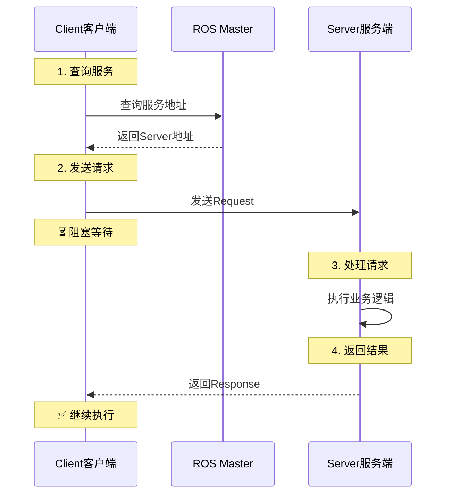
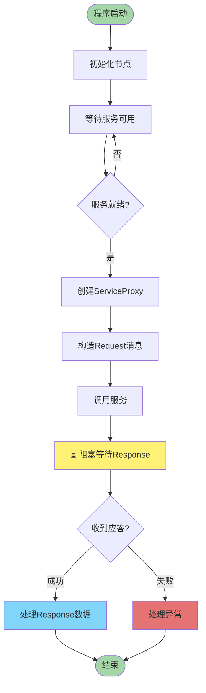
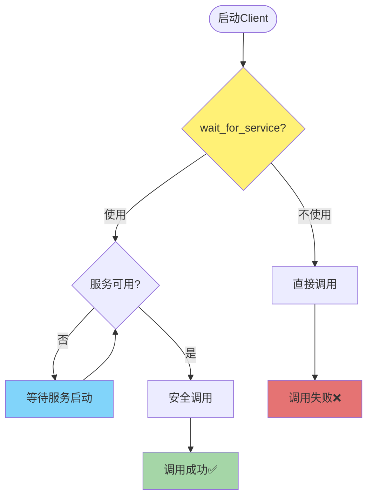

# 📤 ROS Service Client (客户端) 详解

**版权所属: 米醋电子工作室 | KimJong**

---

## 📋 目录

- [基本概念](#基本概念)
- [工作原理](#工作原理)
- [实现流程](#实现流程)
- [Python实现](#python实现)
- [C++实现](#c实现)
- [常见问题](#常见问题)

---

## 🎯 基本概念

### 什么是Service Client?

Service Client(服务客户端)是ROS Service通讯机制中的**请求方**,负责:

- 📤 发送请求(Request)
- ⏳ 阻塞等待应答
- 📥 接收响应(Response)
- ✅ 处理返回结果

### 什么是ServiceProxy(服务代理)?

**ServiceProxy**是Client端用来调用远程服务的**本地代理对象**:


**形象比喻:**

- 你想买东西 → Client程序
- 你找代购 → ServiceProxy代理
- 代购联系卖家 → 网络通信
- 卖家发货 → Server返回结果

**核心作用:**

- 🔒 **封装复杂性**: 隐藏网络通信、序列化等底层细节
- 🎯 **简化调用**: 像调用本地函数一样使用远程服务
- ⚡ **自动处理**: 自动完成数据序列化、网络传输、反序列化

### Client在Service通讯中的角色



---

## 🔧 工作原理

### Client工作机制



### 核心特点

| 特性 | 说明 |
|------|------|
| **阻塞式调用** | 发送请求后必须等待应答才能继续 |
| **同步通讯** | Request和Response是成对出现的 |
| **一对一** | 一个Client对应一个Server |
| **按需调用** | 只在需要时发起请求,不是持续通讯 |
| **可靠性** | 可以确认服务是否成功执行 |

---

## 📝 实现流程

### 编写Client的核心步骤

#### Python实现逻辑 (详见后文简化版)

核心步骤:等待服务 → 创建Proxy → 构造Request → 调用服务

#### C++实现逻辑


**详细步骤:**

1. **包含头文件**
   - `#include "ros/ros.h"`
   - `#include "server_demo_pkg/detect_char.h"`

2. **初始化节点**
   - `ros::init(argc, argv, "client_cpp_node")`

3. **创建NodeHandle**
   - `ros::NodeHandle nh`

4. **创建ServiceClient对象**
   - `ros::ServiceClient client = nh.serviceClient<server_demo_pkg::detect_char>("detect")`
   - 模板参数: 服务数据类型
   - 函数参数: 服务名称

5. **等待服务可用**
   - `ros::service::waitForService("detect")`
   - 阻塞直到server端启动

6. **构造srv对象**
   - `server_demo_pkg::detect_char srv`
   - srv对象包含request和response两部分

7. **设置Request字段**
   - `srv.request.detect_flag = 1`
   - 这是要发送给server端的数据

8. **调用服务**
   - `bool result = client.call(srv)`
   - 阻塞等待server端返回Response
   - 返回bool表示调用是否成功

9. **处理Response**
   - 检查result返回值
   - 从`srv.response`获取server端返回的数据
   - `srv.response.char_type`包含检测结果

---

## 🔷 C++实现

### 完整代码示例

#### 🔄 流程与思路

1. **包含头文件**：包含ROS核心头文件和自定义服务类型头文件
2. **主函数入口**：从main函数开始,获取命令行参数
3. **初始化ROS系统**：使用ros::init()初始化节点
4. **创建节点句柄**：创建ros::NodeHandle对象用于ROS通信
5. **创建ServiceClient**：使用serviceClient()创建Client对象,指定服务类型和名称
6. **等待服务可用**：使用waitForService()阻塞等待Server启动
7. **构造srv对象**：创建服务对象,包含Request和Response两部分
8. **设置Request**：填充Request字段,准备要发送的数据
9. **调用服务**：使用call()方法发送请求并阻塞等待响应
10. **处理Response**：检查返回值,从Response中获取Server返回的数据

```cpp
/**
 * ROS Service Client 示例 - 字符检测服务客户端
 * 功能: 调用字符检测服务,发送检测请求并接收识别结果
 * 版权: 米醋电子工作室 | KimJong
 */

#include "ros/ros.h"
#include "server_demo_pkg/detect_char.h"  // 注意:包名应为server_demo_pkg

int main(int argc, char** argv)
{
    // 1. 初始化ROS节点
    ros::init(argc, argv, "client_cpp_node");

    // 2. 创建节点句柄
    ros::NodeHandle nh;

    // 3. 创建ServiceClient对象
    // 模板参数: 服务数据类型 server_demo_pkg::detect_char
    // 参数: 服务名称 "detect"
    ros::ServiceClient client = nh.serviceClient<server_demo_pkg::detect_char>("detect");

    // 4. 等待服务可用 (阻塞直到server端启动)
    ros::service::waitForService("detect");

    // 5. 构造srv对象 (包含Request和Response)
    server_demo_pkg::detect_char srv;

    // 6. 设置Request字段,这是要发送给server端的数据
    srv.request.detect_flag = 1;

    // 7. 调用服务 (阻塞等待server端的Response)
    bool result = client.call(srv);

    // 8. 处理调用结果
    if (result)
    {
        // 调用成功,srv.response中包含server端返回的数据
        ROS_INFO("SUCCESS 响应结果: %s", srv.response.char_type.c_str());
    }
    else
    {
        // 调用失败
        ROS_ERROR("服务调用失败");
    }

    return 0;
}
```

### C++代码说明

#### 关键API

| API | 功能 | 返回值 |
|-----|------|--------|
| `nh.serviceClient<T>(name)` | 创建ServiceClient对象 | ServiceClient对象 |
| `ros::service::waitForService(name)` | 等待服务可用 | void (阻塞) |
| `client.call(srv)` | 调用服务 | bool (是否成功) |
| `srv.request` | Request部分,发送给server | Request对象 |
| `srv.response` | Response部分,server返回的数据 | Response对象 |

#### srv对象的结构

```cpp
server_demo_pkg::detect_char srv;

// Request部分 - 要发送给server端的数据
srv.request.detect_flag = 1;

// Response部分 - server端返回的数据 (调用call后才有值)
srv.response.char_type;  // 包含server端的响应结果
```

#### 等待服务的方式

本示例使用 `ros::service::waitForService()`:

```cpp
// 阻塞直到服务可用
ros::service::waitForService("detect");
ros::ServiceClient client = nh.serviceClient<server_demo_pkg::detect_char>("detect");
```

**说明:**

- 如果server端未启动,会一直等待
- 确保调用服务前server已经准备好

#### 调用服务并处理结果

```cpp
// 调用服务,返回bool表示是否成功
bool result = client.call(srv);

if (result)
{
    // 成功: srv.response包含server端返回的数据
    ROS_INFO("SUCCESS 响应结果: %s", srv.response.char_type.c_str());
}
else
{
    // 失败: 服务调用失败
    ROS_ERROR("服务调用失败");
}
```

---

## 🐍 Python实现 (简化版)

**核心代码:**

```python
import rospy
from server_demo_pkg.srv import detect_char, detect_charRequest

if __name__ == "__main__":
    rospy.init_node("client_py_node")
    rospy.wait_for_service("detect")  # 等待服务可用

    client = rospy.ServiceProxy("detect", detect_char)
    req = detect_charRequest()
    req.detect_flag = True

    response = client(req)  # 调用服务
    rospy.loginfo("结果: %s", response.char_type)
```

**关键步骤:**

1. 等待服务 `rospy.wait_for_service()`
2. 创建Proxy `rospy.ServiceProxy(name, Type)`
3. 构造Request `req.field = value`
4. 调用服务 `response = client(req)`

---

## ❓ 常见问题

### 1. 为什么要wait_for_service?



**原因:**
- ❌ 不使用: 如果Server未启动,调用会立即失败
- ✅ 使用: 阻塞等待Server启动,确保调用成功

### 2. Client需要spin()吗?

**答: 通常不需要**

```python
# ❌ 错误: Client不需要spin
if __name__ == "__main__":
    rospy.init_node("client")
    client = rospy.ServiceProxy("service", SrvType)
    response = client(request)
    rospy.spin()  # 不需要!

# ✅ 正确: 调用完即可结束
if __name__ == "__main__":
    rospy.init_node("client")
    rospy.wait_for_service("service")
    client = rospy.ServiceProxy("service", SrvType)
    response = client(request)
    # 处理response后程序可以结束
```

**特殊情况需要spin:**
- Client同时也是Subscriber (需要接收其他Topic)
- Client需要持续运行,周期性调用服务

### 3. 如何设置超时?

#### Python超时设置

```python
# 方式1: wait_for_service超时
try:
    rospy.wait_for_service("service_name", timeout=5.0)  # 5秒超时
except rospy.ROSException:
    rospy.logerr("等待服务超时")

# 方式2: 调用超时 (需要persistent=True)
client = rospy.ServiceProxy("service_name", SrvType, persistent=True)
try:
    response = client(request, timeout=3.0)  # 3秒超时
except rospy.ServiceException:
    rospy.logerr("调用超时")
```

#### C++超时设置

```cpp
// 方式1: waitForExistence超时
ros::ServiceClient client = nh.serviceClient<SrvType>("service_name");
if (!client.waitForExistence(ros::Duration(5.0)))  // 5秒超时
{
    ROS_ERROR("等待服务超时");
    return 1;
}

// 方式2: call超时
// 注意: C++的call()本身不支持超时,可以使用异步调用
```

### 4. 一个Client可以调用多次吗?

**答: 可以,而且推荐这样做**

```python
# ✅ 推荐: 创建一次,重复使用
client = rospy.ServiceProxy("service", SrvType)
for i in range(10):
    response = client(request)

# ❌ 不推荐: 每次都创建
for i in range(10):
    client = rospy.ServiceProxy("service", SrvType)  # 浪费资源
    response = client(request)
```

### 5. 如何处理服务不存在的情况?

```python
# Python异常处理
try:
    rospy.wait_for_service("service_name", timeout=5.0)
    client = rospy.ServiceProxy("service_name", SrvType)
    response = client(request)
except rospy.ROSException:
    rospy.logerr("服务不存在或超时")
except rospy.ServiceException as e:
    rospy.logerr("服务调用失败: %s", e)
```

```cpp
// C++检查服务是否存在
ros::ServiceClient client = nh.serviceClient<SrvType>("service_name");

if (!client.waitForExistence(ros::Duration(5.0)))
{
    ROS_ERROR("服务不存在");
    return 1;
}

if (client.call(srv))
{
    ROS_INFO("调用成功");
}
else
{
    ROS_ERROR("调用失败");
}
```

---

## 📝 总结

### Client编程要点

✅ **必做事项:**
1. 在创建Proxy前调用 `wait_for_service()`
2. 使用try-except捕获异常 (Python)
3. 检查call()返回值 (C++)
4. 正确设置Request字段

⚠️ **注意事项:**
1. 调用是阻塞的,会等待Server应答
2. 建议设置超时时间,避免无限等待
3. ServiceProxy可以重复使用,不要每次都创建
4. Client通常不需要spin()

### API速查表

| 功能 | Python | C++ |
|------|--------|-----|
| **等待服务** | `rospy.wait_for_service(name)` | `client.waitForExistence()` |
| **创建Client** | `rospy.ServiceProxy(name, Type)` | `nh.serviceClient<Type>(name)` |
| **调用服务** | `client(req)` 或 `client.call(req)` | `client.call(srv)` |
| **异常处理** | `try-except rospy.ServiceException` | 检查`call()`返回bool |

---

**版权所属: 米醋电子工作室 | KimJong**
**最后更新: 2025年**
