# 📡 ROS服务(Service)通讯机制详解

**版权所属: 米醋电子工作室 | KimJong**

---

## 📋 目录
- [基本概念](#基本概念)
- [Service与Topic对比](#service与topic对比)
- [通讯原理](#通讯原理)
- [Srv数据类型](#srv数据类型)
- [Python实现](#python实现)
- [C++实现](#c实现)
- [应用场景](#应用场景)

---

## 🎯 基本概念

### Service通讯特点

ROS Service(服务)是一种**同步双向、有反馈、阻塞式**的通讯机制:

| 特性 | 说明 |
|------|------|
| **通讯方式** | 同步双向通讯 |
| **反馈机制** | 有请求有应答 |
| **执行模式** | 阻塞式,需要等待应答后才能继续 |
| **触发方式** | 按需请求,不是持续发布 |
| **数据流向** | Client发送Request → Server返回Response |

### 角色说明

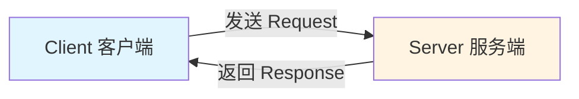

**📤 Client(客户端)**
- 发送请求(Request)
- 等待应答(阻塞)
- 接收响应(Response)
- 处理响应数据

**📥 Server(服务端)**
- 监听请求
- 接收Request
- 处理业务逻辑
- 返回Response

---

## 📊 Service与Topic对比

### 完整对比表格

| 对比项 | Topic(话题) | Service(服务) |
|--------|-------------|---------------|
| **通讯方式** | 异步单向 | 同步双向 |
| **反馈机制** | 无反馈 | 有反馈 |
| **执行模式** | 非阻塞,持续发布 | 阻塞,等待应答 |
| **触发方式** | 持续发布 | 按需请求 |
| **数据流向** | Publisher → Subscriber | Client ⇄ Server |
| **映射关系** | 一对多(广播) | 一对一(点对点) |
| **通讯原理** | 消息队列 | RPC(远程过程调用) |
| **数据类型** | .msg文件 | .srv文件(Request+Response) |
| **适用场景** | 传感器数据、状态发布 | 任务触发、参数查询 |
| **实时性** | 高(持续更新) | 中(按需调用) |
| **资源消耗** | 持续占用带宽 | 仅请求时占用 |

### 通讯原理对比

#### Topic原理 - 消息队列

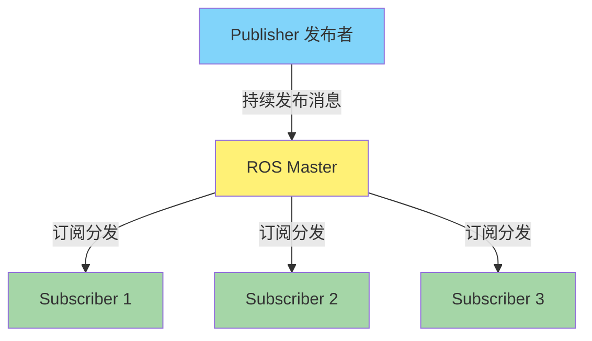

**特点:** 一对多广播,Publisher不关心有多少Subscriber,持续发布数据

#### Service原理 - RPC(远程过程调用)

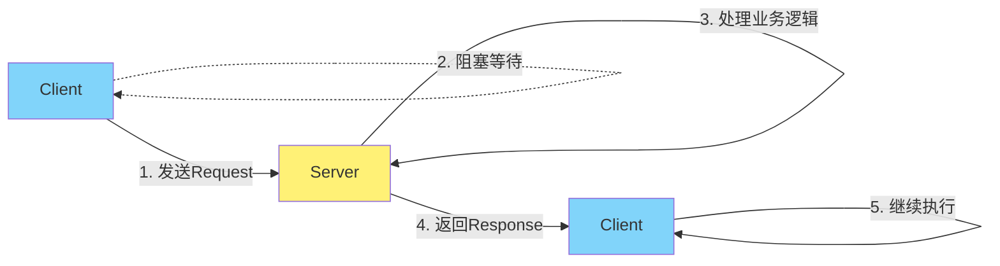

**特点:** 一对一点对点,Client必须等待Server应答才能继续

**💡 RPC vs 本地调用:**
- **本地调用**: 函数调用在同一进程内,直接跳转
- **RPC调用**: 函数调用在不同进程/节点,通过网络通讯
- **ROS Service**: 基于RPC,Client调用Server就像调用本地函数一样

---

## 🔧 通讯原理

### Service通讯流程

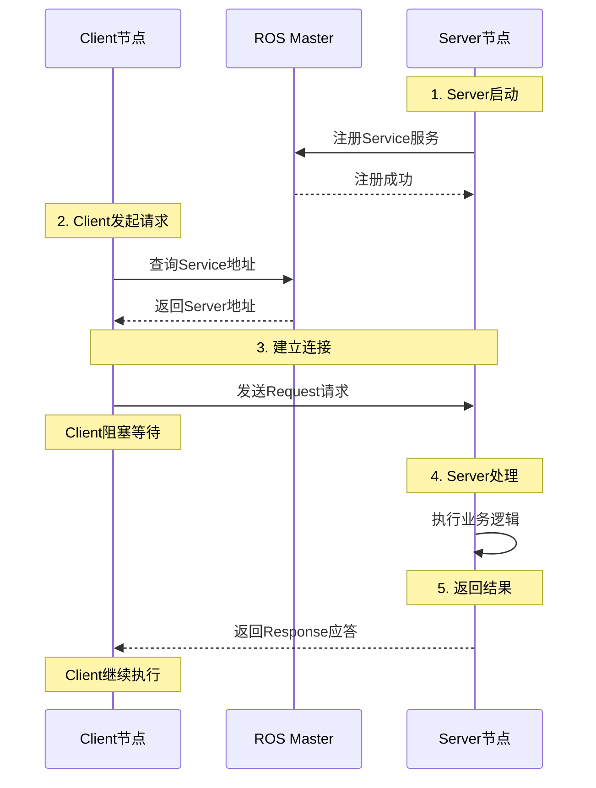

### 执行时序说明

1. **服务注册**: Server节点启动时向ROS Master注册服务
2. **服务发现**: Client向ROS Master查询服务地址
3. **建立连接**: Client与Server建立TCP连接
4. **发送请求**: Client发送Request,进入**阻塞状态**
5. **处理请求**: Server接收Request,执行业务逻辑
6. **返回应答**: Server返回Response
7. **继续执行**: Client接收Response,**解除阻塞**,继续后续代码

---

## 📦 Srv数据类型

### Srv文件结构

Service使用`.srv`文件定义数据结构,对应Topic的`.msg`文件。

**基本格式:**

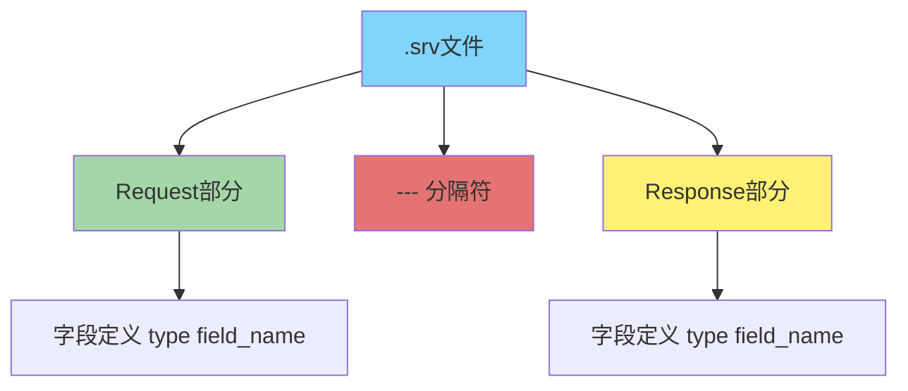

**文本格式:**
```
Request字段定义
---
Response字段定义
```

### 示例1: 简单检测服务

**文件: `DetectChar.srv`**
```srv
# Request部分 - 客户端发送的请求
bool detect_flag         # 是否开始检测
---
# Response部分 - 服务端返回的应答  (短横线分隔)
string char_type         # 检测到的字符类型
```

**字段说明:**
- `detect_flag`: Request字段,bool类型,表示是否触发检测
- `---`: **分隔符**(必须),上方是Request,下方是Response
- `char_type`: Response字段,string类型,返回检测结果

### 示例2: 加法运算服务

**文件: `AddTwoInts.srv`**
```srv
# Request - 两个整数
int64 a
int64 b
---
# Response - 求和结果
int64 sum
```

### 示例3: 路径规划服务

**文件: `GetPlan.srv`**
```srv
# Request - 起点和终点
geometry_msgs/PoseStamped start      # 起点位姿
geometry_msgs/PoseStamped goal       # 终点位姿
float32 tolerance                    # 容差范围
---
# Response - 规划路径
nav_msgs/Path plan                   # 规划的路径
bool success                         # 是否成功
```

### 常用数据类型

| 类型 | 说明 | 示例 |
|------|------|------|
| `bool` | 布尔型 | true/false |
| `int8/16/32/64` | 整型 | 123 |
| `float32/64` | 浮点型 | 3.14 |
| `string` | 字符串 | "hello" |
| `时间类型` | time/duration | - |
| `数组` | type[] | int32[] |
| `其他msg` | geometry_msgs/Pose | 复合类型 |

---

## 💻 实现方式

### Python实现概要

#### Server端实现流程

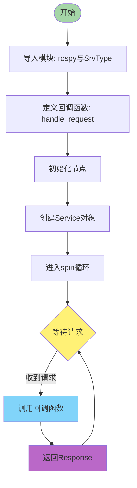

#### Client端实现流程

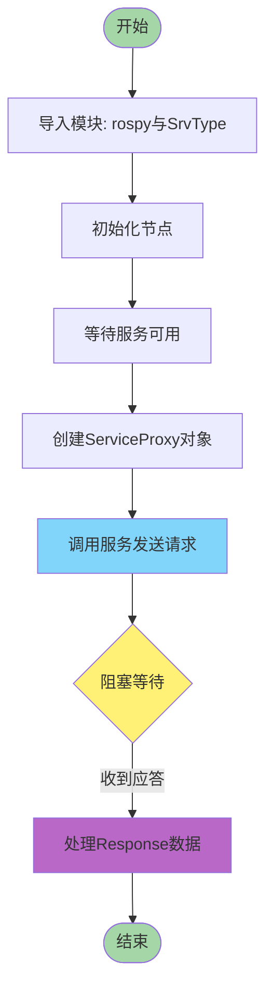

**详细实现见:** [ROS_srv_Python.md](ROS_srv_Python.md)

---

### C++实现概要

#### Server端实现流程

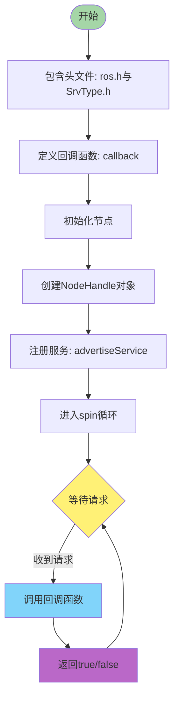

#### Client端实现流程

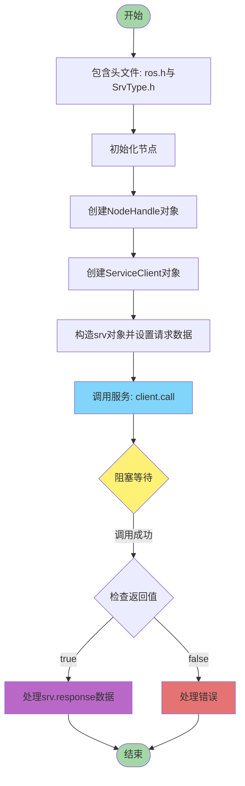

**详细实现见:** [ROS_srv_Cpp.md](ROS_srv_Cpp.md)

---

## 🎯 应用场景

### 场景分类

| 场景类型 | 说明 | 特点 |
|----------|------|------|
| **任务触发** | 执行一次性任务 | 按需调用,有明确结果 |
| **参数查询** | 获取系统参数 | 请求-应答模式 |
| **状态切换** | 改变节点状态 | 需要确认是否成功 |
| **数据处理** | 复杂计算或转换 | 阻塞等待处理完成 |

### 典型应用举例

#### 1. 机器人控制场景

**场景:** 控制机械臂移动到指定位置

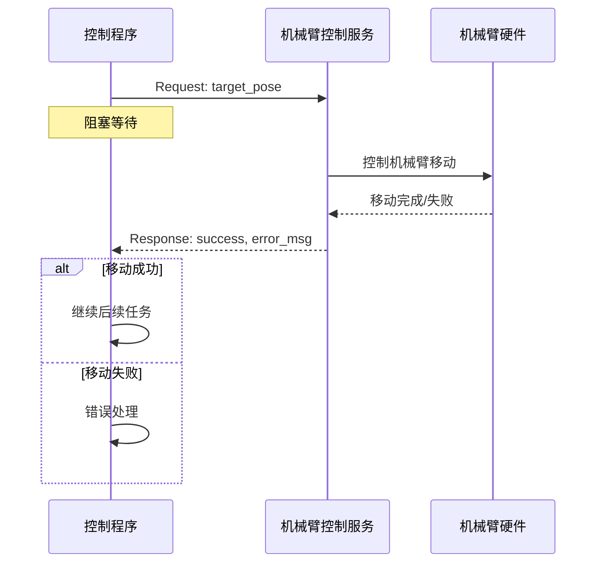

**Service定义:**
- 服务名: `/move_arm`
- Request: `target_pose` (目标位姿)
- Response: `success` (是否成功), `error_msg` (错误信息)

---

#### 2. 视觉识别场景

**场景:** 触发字符识别,等待识别结果

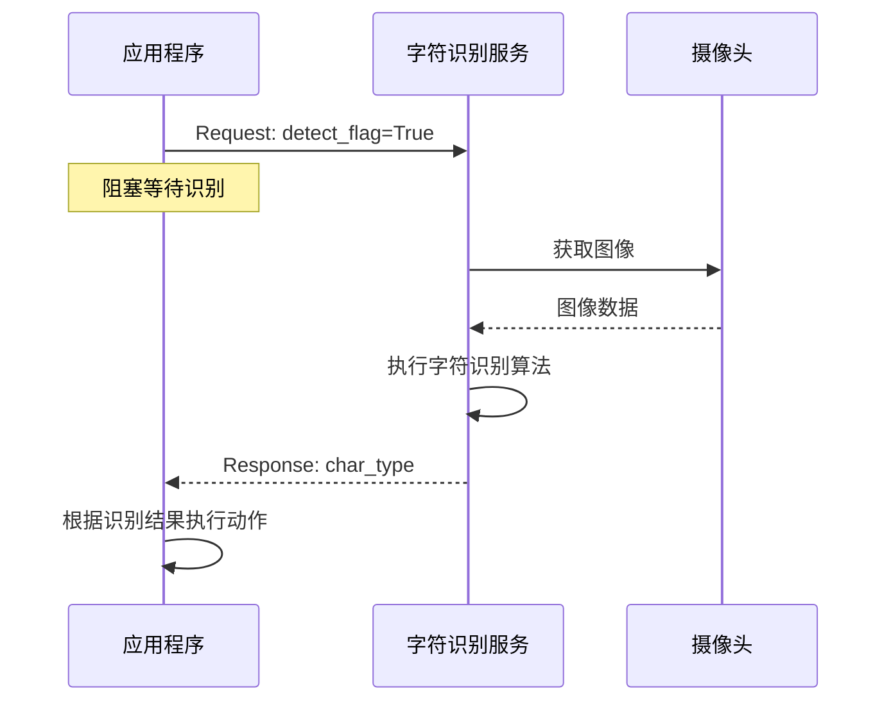

**Service定义:**
- 服务名: `/detect_char`
- Request: `detect_flag` (是否开始识别)
- Response: `char_type` (识别出的字符类型)

---

#### 3. 路径规划场景

**场景:** 请求从A点到B点的路径规划

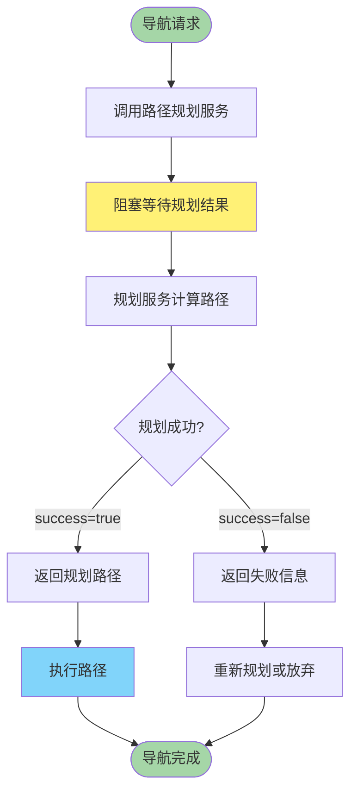

**Service定义:**
- 服务名: `/get_plan`
- Request: `start` (起点), `goal` (终点), `tolerance` (容差)
- Response: `plan` (规划路径), `success` (是否成功)

---

#### 4. 参数查询场景

**场景:** 查询机器人当前配置参数

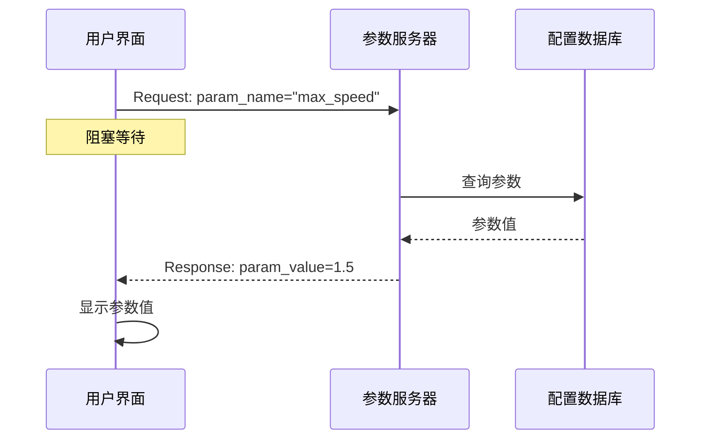

**Service定义:**
- 服务名: `/get_robot_config`
- Request: `param_name` (参数名称)
- Response: `param_value` (参数值)

### Service vs Topic 选择指南

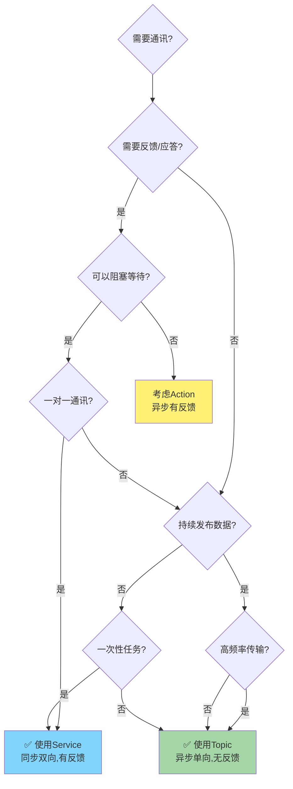

**使用Service的场景:**

- ✅ 需要确认操作是否成功
- ✅ 一次性任务触发
- ✅ 请求-应答模式
- ✅ 不需要持续数据流
- ✅ 可以接受阻塞等待

**使用Topic的场景:**

- ✅ 持续发布数据(如传感器数据)
- ✅ 一对多广播
- ✅ 不需要反馈
- ✅ 高频率数据传输
- ✅ 不能阻塞的场景

---

## 📝 总结

### 核心要点

1. **Service是同步双向通讯**: Client发送Request,阻塞等待Server返回Response
2. **基于RPC原理**: 远程调用就像调用本地函数
3. **一对一映射**: Client和Server点对点通讯
4. **按需触发**: 不是持续发布,而是需要时才请求
5. **适用于任务触发**: 有明确请求和应答的场景

### 关键API对比

| 功能 | Python | C++ |
|------|--------|-----|
| **Server创建** | `rospy.Service()` | `nh.advertiseService()` |
| **Client创建** | `rospy.ServiceProxy()` | `nh.serviceClient<T>()` |
| **等待服务** | `rospy.wait_for_service()` | `client.waitForExistence()` |
| **调用服务** | `proxy(req)` | `client.call(srv)` |
| **回调函数** | `def callback(req): return res` | `bool callback(req, res)` |

### 注意事项

⚠️ **阻塞问题**: Client调用服务时会阻塞,如果Server处理时间长,Client会一直等待
⚠️ **超时处理**: 建议设置超时时间,避免无限等待
⚠️ **异常处理**: 服务可能失败,需要try-catch处理异常
⚠️ **服务可用性**: 调用前需要确认服务已启动(wait_for_service)

---

**版权所属: 米醋电子工作室 | KimJong**
**最后更新: 2025年**
