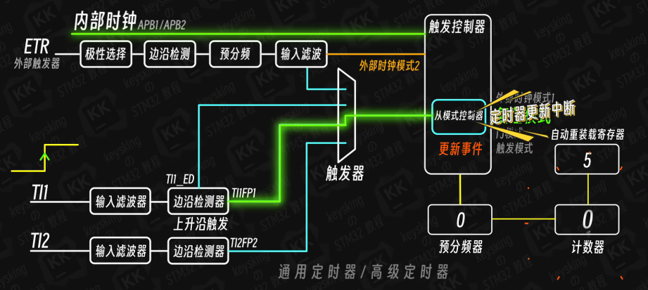
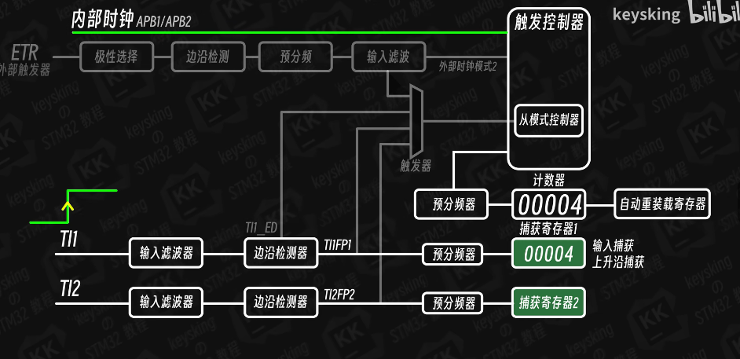
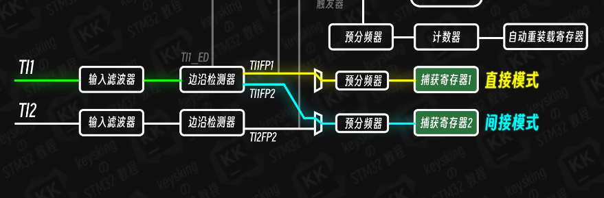

# STM32定时器从模式的应用

## 从模式分类

定时器从模式分为四种：
- **外部时钟模式1** (External Clock Mode 1)：外部信号作为时钟源
- **复位模式** (Reset Mode)：外部信号触发计数器复位
- **门模式** (Gated Mode)：外部信号控制计数器启停
- **触发模式** (Trigger Mode)：外部信号触发启动计数

---

## 1. 复位模式

### 工作原理

复位模式通过外部信号作为触发源，当检测到特定触发信号时，计数器会立即复位到0。

**示例场景**：
- 自动重装载值设置为5
- 当TI1输入有一个上升沿后，无论计数器当前值是多少，都会被立即清0



### 应用场景

复位模式常用于：
- 需要外部信号同步的测量
- 相位差测量
- 脉宽测量（配合捕获模式）
- 外部事件触发的精确计时重置

### 代码实现

```c
// 复位模式配置
void TIMx_ResetMode_Config(void)
{
    TIM_SlaveConfigTypeDef sSlaveConfig = {0};

    // 配置从模式为复位模式
    sSlaveConfig.SlaveMode = TIM_SLAVEMODE_RESET;        // 复位模式
    sSlaveConfig.InputTrigger = TIM_TS_TI1FP1;          // TI1作为触发输入
    sSlaveConfig.TriggerPolarity = TIM_TRIGGERPOLARITY_RISING;  // 上升沿触发
    sSlaveConfig.TriggerPrescaler = TIM_TRIGGERPRESCALER_DIV1;  // 1分频
    sSlaveConfig.TriggerFilter = 0;                     // 无滤波

    HAL_TIM_SlaveConfigSynchro(&htimx, &sSlaveConfig);

    // 设置自动重装载值
    __HAL_TIM_SET_AUTORELOAD(&htimx, 5-1);  // 设置为5

    // 启动定时器
    HAL_TIM_Base_Start(&htimx);
}

// 可以配合输入捕获功能
void HAL_TIM_IC_CaptureCallback(TIM_HandleTypeDef *htim)
{
    if(htim->Channel == HAL_TIM_ACTIVE_CHANNEL_1)
    {
        // TI1捕获到信号时的处理
        uint32_t capture = HAL_TIM_ReadCapturedValue(htim, TIM_CHANNEL_1);
        // 处理捕获值
    }
}
```

---

## 2. 门模式

### 工作原理

门模式中，外部信号控制计数器的启停：
- 信号为高电平时：计数器正常计数
- 信号为低电平时：计数器停止计数



### 输入捕获原理

门模式通过捕获寄存器完成脉冲宽度测量：
- **限制**：无法设置双边沿捕获，只能选择上升沿或下降沿捕获
- **通道映射**：
  - 直接模式：TI1FP1（来自TI1）
  - 间接模式：TI1FP2（来自TI2）



### 关键函数说明

**HAL_TIM_IC_Start()函数**：开启输入捕获，通常需要开启两个通道：
- 一个检测上升沿
- 一个检测下降沿

**重要提示**：
- 最好在每次计数之前清空计数器：`__HAL_TIM_SET_COUNTER(&htimx, 0)`
- 输入捕获回调函数：`HAL_TIM_IC_CaptureCallback()`

### 应用示例：脉冲宽度测量

```c
// 示例：测量脉冲宽度
// 设置一个GPIO输出低电平，先拉高延时1ms再拉低
// 然后通过下降沿-上升沿的时间差获取高电平持续时间

void TIMx_GatedMode_Config(void)
{
    TIM_SlaveConfigTypeDef sSlaveConfig = {0};
    TIM_IC_InitTypeDef sConfigIC = {0};

    // 配置从模式为门模式
    sSlaveConfig.SlaveMode = TIM_SLAVEMODE_GATED;      // 门模式
    sSlaveConfig.InputTrigger = TIM_TS_TI1FP1;         // TI1作为门控信号
    sSlaveConfig.TriggerPolarity = TIM_TRIGGERPOLARITY_RISING;  // 上升沿开始计数
    sSlaveConfig.TriggerPrescaler = TIM_TRIGGERPRESCALER_DIV1;
    sSlaveConfig.TriggerFilter = 0;

    HAL_TIM_SlaveConfigSynchro(&htimx, &sSlaveConfig);

    // 配置输入捕获通道1 - 上升沿捕获
    sConfigIC.ICPolarity = TIM_ICPOLARITY_RISING;
    sConfigIC.ICSelection = TIM_ICSELECTION_DIRECTTI;   // 直接模式TI1
    sConfigIC.ICPrescaler = TIM_ICPSC_DIV1;
    sConfigIC.ICFilter = 0;
    HAL_TIM_IC_ConfigChannel(&htimx, &sConfigIC, TIM_CHANNEL_1);

    // 配置输入捕获通道2 - 下降沿捕获
    sConfigIC.ICPolarity = TIM_ICPOLARITY_FALLING;
    sConfigIC.ICSelection = TIM_ICSELECTION_INDIRECTTI;  // 间接模式TI1FP2
    HAL_TIM_IC_ConfigChannel(&htimx, &sConfigIC, TIM_CHANNEL_2);

    // 启动输入捕获
    HAL_TIM_IC_Start(&htimx, TIM_CHANNEL_1);
    HAL_TIM_IC_Start(&htimx, TIM_CHANNEL_2);

    // 清空计数器
    __HAL_TIM_SET_COUNTER(&htimx, 0);
}

// 输入捕获回调函数
void HAL_TIM_IC_CaptureCallback(TIM_HandleTypeDef *htim)
{
    static uint32_t uwRising_Capture = 0;
    static uint32_t uwFalling_Capture = 0;

    if(htim->Channel == HAL_TIM_ACTIVE_CHANNEL_1)
    {
        // 上升沿捕获
        uwRising_Capture = HAL_TIM_ReadCapturedValue(htim, TIM_CHANNEL_1);
        __HAL_TIM_SET_COUNTER(htim, 0);  // 清空计数器
    }
    else if(htim->Channel == HAL_TIM_ACTIVE_CHANNEL_2)
    {
        // 下降沿捕获
        uwFalling_Capture = HAL_TIM_ReadCapturedValue(htim, TIM_CHANNEL_2);

        // 计算高电平持续时间
        uint32_t high_duration = uwFalling_Capture - uwRising_Capture;

        // 处理测量结果
    }
}

// 测试示例：产生测试脉冲
void TestPulseGeneration(void)
{
    // 设置GPIO为输出
    GPIO_InitTypeDef GPIO_InitStruct = {0};
    GPIO_InitStruct.Pin = GPIO_PIN_x;
    GPIO_InitStruct.Mode = GPIO_MODE_OUTPUT_PP;
    HAL_GPIO_Init(GPIOx, &GPIO_InitStruct);

    // 产生测试脉冲：先拉低，再拉高1ms，再拉低
    HAL_GPIO_WritePin(GPIOx, GPIO_PIN_x, GPIO_PIN_RESET);
    HAL_Delay(10);
    HAL_GPIO_WritePin(GPIOx, GPIO_PIN_x, GPIO_PIN_SET);
    HAL_Delay(1);  // 高电平1ms
    HAL_GPIO_WritePin(GPIOx, GPIO_PIN_x, GPIO_PIN_RESET);
}
```

---

## 3. 外部时钟模式1

### 基本概念

外部信号作为时钟源，常用于外部脉冲计数。每当外部信号产生一个上升沿（或下降沿）时，计数器加1。

### 应用场景

- 编码器脉冲计数
- 外部事件计数
- 频率测量

---

## 4. 触发模式

### 工作原理

外部信号触发启动计数，计数器从0开始计数，直到达到自动重装载值后停止。

### 应用场景

- 单次定时测量
- 外部触发的精确定时
- 时间间隔测量

---

## 总结

从模式使得定时器能够响应外部事件，扩展了定时器的应用范围：

1. **复位模式**：外部同步，立即复位
2. **门模式**：测量脉冲宽度，控制计数启停
3. **外部时钟模式1**：外部脉冲计数
4. **触发模式**：外部触发单次计数

选择合适的从模式可以根据具体应用需求实现精确的时序控制和测量。