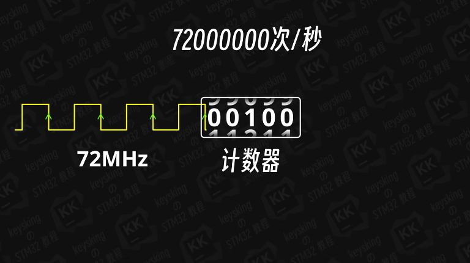
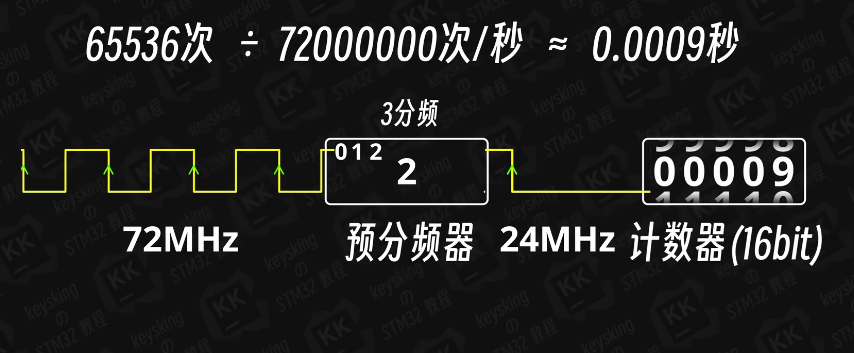

# STM32基本定时器

定时器就是计数器！

## 定时器分类

三类：
- 基本定时器
- 通用定时器
- 高级定时器 （工业电机等功能）

## 工作原理

基本定时器就是计数器，72MHZ的晶振一秒能发出72MHZ数量的上升沿。
计数器每遇到一个上升沿计数值+1，也就是加到72MHZ是一秒。



## 预分频器

由于计数器是16bit，所以我们引入预分频器，n分频设置为n-1。



## 定时器串联

定时器可以串联，通过一个定时器的输出是另一个定时器的输入信号。

## 自动重装载

通过自动重装载来触发定时器中断，如定时器到3后直接变成0，那么计数器的值就是 0 1 2 3这四次，所以定几次应该是n-1。

## 代码实现

启动定时器：
```c
HAL_TIM_BASE_Start();  // 启动定时器
HAL_TIM_BASE_Start_IT();  // 启动定时器并使能中断
```

使用中断触发，触发后会进入中断回调函数：
```c
void HAL_TIM_PeriodElapsedCallback(TIM_HandleTypeDef *htim)
{
    // 定时器中断处理代码
}
```

## 寄存器设置

通过HAL库底层的API可以对寄存器进行设置：


