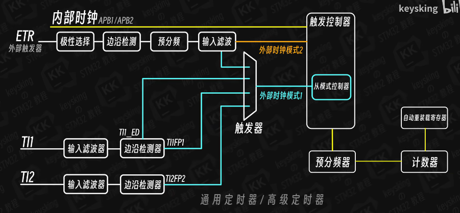
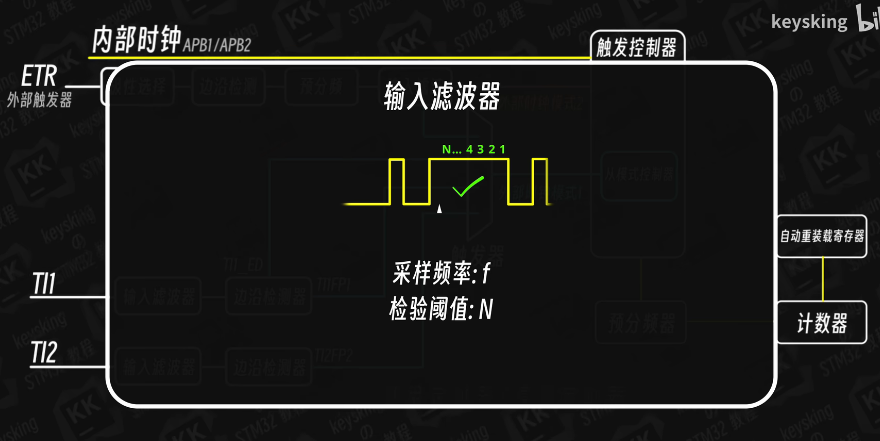

# STM32外部定时器

## 外部触发器ETR

### 外部时钟原理



时钟检测分为3种：
- 上升沿检测
- 下降沿检测
- 双边沿检测

外部时钟分为两种方式：
- ETR2：直接进入触发器
- ETR1：通过选择进入触发器，从模式触发器进入

### 应用场景

**黑白条纹测速**：
黑白条通过红外计数产生方波，方波输入到外部触发定时器中可以计算出时间。

## 输入滤波器

在实际应用中会出现抖动脉冲，我们需要输入滤波器来消除干扰。



**滤波器设置**：
- Clock Filter 设置：绝大多数情况下直接填写 15 即可
- 主频过高会导致输入滤波器检测过快，滤不掉抖动
- 解决方案：
  1. 降低主频
  2. 减少APB总线上的时钟频率

## 代码实现

外部触发也要启动定时器，示例代码：

```c
// 外部时钟模式配置
void TIMx_ETR_Config(void)
{
    TIM_SlaveConfigTypeDef sSlaveConfig = {0};

    // 配置定时器为外部时钟模式
    sSlaveConfig.SlaveMode = TIM_SLAVEMODE_EXTERNAL1;  // 外部时钟模式1
    sSlaveConfig.InputTrigger = TIM_TS_ETRF;           // ETR作为触发输入
    sSlaveConfig.TriggerPolarity = TIM_TRIGGERPOLARITY_RISING;  // 上升沿触发
    sSlaveConfig.TriggerPrescaler = TIM_TRIGGERPRESCALER_DIV1;  // 1分频
    sSlaveConfig.TriggerFilter = 15;                   // 滤波器设置为15

    HAL_TIM_SlaveConfigSynchro(&htimx, &sSlaveConfig);

    // 启动定时器
    HAL_TIM_Base_Start(&htimx);
}

// 在中断回调函数中读取计数值
void HAL_TIM_PeriodElapsedCallback(TIM_HandleTypeDef *htim)
{
    if(htim->Instance == TIMx)
    {
        uint32_t count = __HAL_TIM_GET_COUNTER(htim);
        // 处理计数值，计算速度等
    }
}
```