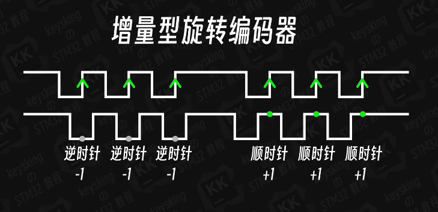
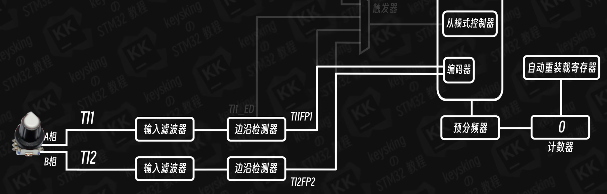
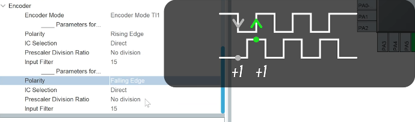

# STM32编码器基本原理

## 编码器检测原理

### 正反转判断

**顺时针旋转**：B相先有上升沿，A相差90度再有上升沿，当A上升沿时，B是高电平


**逆时针旋转**：A相先有上升沿，B相差90度再有上升沿，当A上升沿时，B是低电平


通过检测A相和B相的相位关系来判断旋转方向，具体实现方式可能因编码器型号而有所不同。



### 硬件编码器模式

如果通过软件判断会丢步（丢失计数），所以使用高级定时器的编码器功能：
- 直接连接两个信号到定时器通道
- 选择组合通道设置为编码器模式
- 无需内部时钟源，使用外部时钟触发



## 代码实现

### 启动编码器

```c
// 启动编码器函数
HAL_TIM_Encoder_Start(&htimx, TIM_CHANNEL_ALL);  // 启动所有通道

// 带中断的启动
HAL_TIM_Encoder_Start_IT(&htimx, TIM_CHANNEL_ALL);  // 启动并使能中断
```

### 编码器配置

```c
// 编码器模式配置
void TIMx_Encoder_Config(void)
{
    TIM_Encoder_InitTypeDef sConfig = {0};
    TIM_MasterConfigTypeDef sMasterConfig = {0};

    // 配置编码器模式
    sConfig.EncoderMode = TIM_ENCODERMODE_TI12;        // 使用TI1和TI2
    sConfig.IC1Filter = 0;                            // 输入捕获1滤波器
    sConfig.IC1Polarity = TIM_ICPOLARITY_RISING;      // TI1上升沿
    sConfig.IC1Prescaler = TIM_ICPSC_DIV1;            // 1分频
    sConfig.IC1Selection = TIM_ICSELECTION_DIRECTTI;  // 直接输入

    sConfig.IC2Filter = 0;                            // 输入捕获2滤波器
    sConfig.IC2Polarity = TIM_ICPOLARITY_RISING;      // TI2上升沿
    sConfig.IC2Prescaler = TIM_ICPSC_DIV1;            // 1分频
    sConfig.IC2Selection = TIM_ICSELECTION_DIRECTTI;  // 直接输入

    HAL_TIM_Encoder_Init(&htimx, &sConfig);

    // 设置自动重装载值
    __HAL_TIM_SET_AUTORELOAD(&htimx, 65535);  // 16位最大值

    // 主模式配置（如果需要）
    sMasterConfig.MasterOutputTrigger = TIM_TRGO_RESET;
    sMasterConfig.MasterSlaveMode = TIM_MASTERSLAVEMODE_DISABLE;
    HAL_TIMEx_MasterConfigSynchronization(&htimx, &sMasterConfig);
}
```

### 读取编码器值

```c
// 读取编码器计数值
int32_t Read_Encoder_Value(void)
{
    return (int32_t)(__HAL_TIM_GET_COUNTER(&htimx));
}

// 清零编码器计数值
void Reset_Encoder_Value(void)
{
    __HAL_TIM_SET_COUNTER(&htimx, 0);
}

// 获取旋转方向
int Get_Encoder_Direction(void)
{
    // 读取方向状态
    if(__HAL_TIM_IS_TIM_COUNTING_DOWN(&htimx))
    {
        return -1;  // 反向
    }
    else
    {
        return 1;   // 正向
    }
}
```

## 编码器使用技巧

### 预分频设置

编码器每次会产生两个计数（A相和B相各一次），如果需要提高精度：
- 通过预分频器设置为2分频
- 这样每个脉冲只计数一次

### 相位调整

如果需要换相（改变旋转方向的定义）：
1. 可以调换B相的连接
2. 或者在软件中反转A相的电平



通过合理的相位配置，可以得到正确的正反转效果。在软件中也可以通过简单的逻辑判断来实现反向。

### 中断处理

```c
// 编码器更新中断回调函数
void HAL_TIM_PeriodElapsedCallback(TIM_HandleTypeDef *htim)
{
    if(htim->Instance == TIMx)
    {
        // 处理编码器溢出或特定位置到达
        // 可以用于计算速度或位置控制
    }
}
```