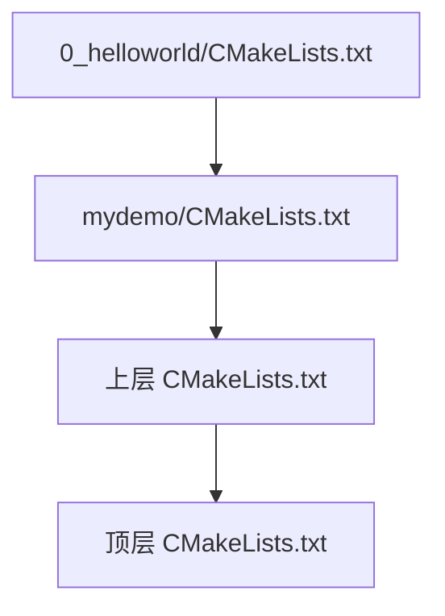

## 1 星闪介绍

### 1.1 了解 SDK

| **一级目录**       | **功能描述**                                      | **核心作用**                                                 | **来源引用** |
| ------------------ | ------------------------------------------------- | ------------------------------------------------------------ | ------------ |
| **application**    | 存放与开发板具体业务逻辑相关的代码。              | **二次开发核心区**。开发者在此实现产品的特定功能、业务流程及应用逻辑，调用底层接口控制设备。 |              |
| **bootloader**     | 存放设备的引导加载程序代码。                      | **系统启动**。负责芯片上电后的硬件初始化（如时钟），并加载启动 LiteOS 操作系统及应用程序。 |              |
| **build**          | 包含编译脚本、链接脚本、Makefile/CMake 配置文件。 | **编译控制**。定义编译流程，同时也作为编译产生的中间文件或最终 `.bin`/`.elf` 文件的输出目录。 |              |
| **drivers**        | 存放 WS63 芯片上各种硬件外设的驱动代码。          | **硬件抽象**。提供 GPIO, UART, SPI, I2C, Wi-Fi, SLE 等外设的操作接口，屏蔽底层寄存器细节。 |              |
| **kernel**         | 存放 LiteOS 操作系统的内核代码或预编译库。        | **系统基石**。提供任务调度、内存管理、中断处理、定时器、进程间通信 (IPC) 等核心操作系统功能。 |              |
| **middleware**     | 存放介于内核与应用之间的通用软件组件。            | **通用服务**。提供网络协议栈 (TCP/IP, MQTT)、文件系统、安全算法库、图形库等中间件能力。 |              |
| **include**        | 存放项目级共享的头文件 (`.h`)。                   | **接口定义**。包含全局函数声明、宏定义和数据结构，确保不同模块间能正确引用接口和共享数据。 |              |
| **interim_binary** | 存放编译或链接过程中生成的临时二进制文件。        | **编译缓存**。存储预编译库或固件片段，用于加速编译过程或保护核心代码知识产权。 |              |
| **libs_url**       | 包含外部依赖库的链接信息或下载脚本。              | **依赖管理**。用于管理和下载项目依赖的第三方开源代码库，确保开发环境完整性。 |              |
| **protocol**       | 存放通信协议栈相关代码。                          | **协议处理**。处理特定的通信协议逻辑（如特定行业的私有协议栈）。 |              |
| **tools**          | 存放开发辅助工具脚本。                            | **辅助开发**。包含烧录脚本、调试工具、镜像打包工具（如 `build.py`）等。 |              |
| **open_source**    | 存放集成的第三方开源代码。                        | **开源集成**。统一管理项目中使用的开源软件组件。             |              |

### 1.2 CMake + Kconfig 编译链

WS63 SDK 采用 **配置驱动构建** 的机制。

#### 1.2.1 核心概念

- **Kconfig (开关定义)**：
  - 负责在 `menuconfig` 图形化界面中生成配置菜单。
  - 用户选中某个选项后，系统会自动生成一个宏定义（以 `CONFIG_` 开头）。
- **CMake (构建逻辑)**：
  - 负责读取 Kconfig 生成的宏定义。
  - 根据宏定义是否存在，决定是否将对应的源码目录 (`add_subdirectory`) 或文件 (`SOURCES`) 加入编译列表。

#### 1.2.2 联动流程图

代码段：


#### 1.2.3 Kconfig 配置块详解

一个标准的 Kconfig 配置项包含以下要素：

代码段：

```
config ENABLE_MICU_SAMPLE              # 1. 配置项名称 (生成的宏为 CONFIG_ENABLE_MICU_SAMPLE)
    bool                               # 2. 类型：布尔型 (y/n)
    prompt "Enable the Sample of MICU" # 3. 提示文案：显示在菜单中的名字
    default n                          # 4. 默认值：关闭
    depends on SAMPLE_ENABLE           # 5. 依赖：只有父开关打开，此项才显示
    help                               # 6. 帮助信息
        This option means enable the sample of MICU.

# 联动逻辑：当开关打开时，引入子目录的配置文件
if ENABLE_MICU_SAMPLE
    osource "application/samples/micu/Kconfig"
endif
```


#### 1.2.4 CMake 构建脚本详解

在 WS63 SDK 中，子目录的 `CMakeLists.txt` 并不直接执行编译，而是负责**收集**本目录下的源文件和头文件路径，并将其**传递**给上层构建系统。

代码段：

```
# 1. 定义本模块需要编译的源文件列表 (.c)
set(SOURCES_LIST
    ${CMAKE_CURRENT_SOURCE_DIR}/wifi/wifi_connect.c
    ${CMAKE_CURRENT_SOURCE_DIR}/sntp_demo.c
    ${CMAKE_CURRENT_SOURCE_DIR}/ssd1306/ssd1306_fonts.c
    ${CMAKE_CURRENT_SOURCE_DIR}/ssd1306/ssd1306.c
)

# 2. 定义本模块对外暴露的头文件目录路径 (include path)
set(HEADER_LIST
    ${CMAKE_CURRENT_SOURCE_DIR}/wifi
    ${CMAKE_CURRENT_SOURCE_DIR}/ssd1306
)

# 3. 【关键】将本地列表追加到全局变量，并提升作用域
set(SOURCES "${SOURCES}" ${SOURCES_LIST} PARENT_SCOPE)
set(PUBLIC_HEADER "${PUBLIC_HEADER}" ${HEADER_LIST} PARENT_SCOPE)
```

- **`set(SOURCES_LIST ...)`**:
  - 创建一个**局部变量** `SOURCES_LIST`。
  - `${CMAKE_CURRENT_SOURCE_DIR}` 是 CMake 内置变量，代表当前 `CMakeLists.txt` 所在的绝对路径。使用绝对路径可以避免编译时的路径找不到问题。
- **`set(HEADER_LIST ...)`**:
  - 创建一个**局部变量** `HEADER_LIST`，存放 `.h` 文件所在的文件夹路径。
  - 这相当于告诉编译器 `-I/path/to/wifi`，这样你在代码里就可以直接写 `#include "wifi_connect.h"` 而不用写相对路径。
- **`set(SOURCES "${SOURCES}" ${SOURCES_LIST} PARENT_SCOPE)`**:
  - 这是最核心的一句。
  - `SOURCES` 是 SDK 顶层定义的一个**全局变量**，里面装着所有需要编译的文件。
  - "${SOURCES}" ${SOURCES_LIST} 的意思是：把**原有的**全局文件列表，和**我这个目录新增的**文件列表拼在一起。
  - **`PARENT_SCOPE` (父作用域)**：这是关键！如果没有这个关键字，`SOURCES` 变量的修改只在当前文件夹有效，出了这个文件夹就失效了。加上它，就是告诉 CMake：“**请把我整理好的这份文件清单，上报给我的上级（父目录），让他把它加入总编译列表。**”
- **`set(PUBLIC_HEADER ... PARENT_SCOPE)`**:
  - 原理同上。将本模块的头文件路径上报给父级，使得其他模块也能引用你的头文件（如果构建系统允许）。

#### 1.2.5 目录规划

我们需要构建如下文件结构：

```
src/application/samples/
├── Kconfig                 <-- [SDK级] 总配置入口
├── CMakeLists.txt          <-- [SDK级] 总构建入口
├── mydemo/                   <-- [模块级] 新建自定义模块
│   ├── Kconfig             <-- [模块级] 定义子功能开关
│   ├── CMakeLists.txt      <-- [模块级] 分发子功能编译
│   └── 0_helloworld/       <-- [源码级] 具体功能实现
│       ├── CMakeLists.txt  <-- [源码级] 加入源文件
│       └── main.c          <-- [源码级] 业务代码
```

#### 1.2.6 小结（个人整理）

**构建顺序（图示）**



**分工理解**
- **CMake**：负责具体的构建流程与源码/头文件的收集与传递。
- **Kconfig**：负责配置图形化界面与选项控制，决定哪些模块进入构建流程。
