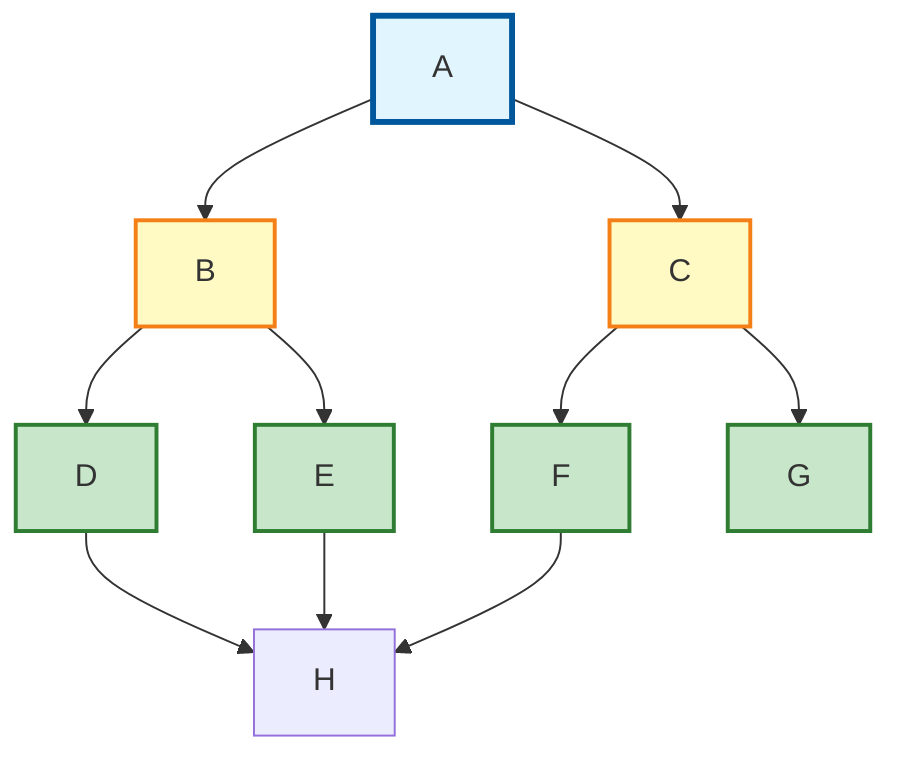
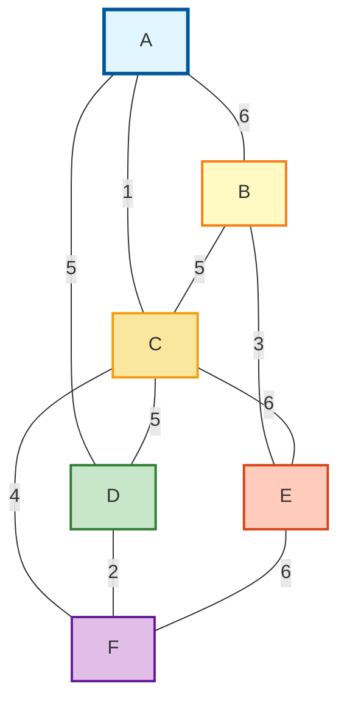

# 图的遍历

## 示例图结构



> **遍历方式对比：**
> - **深度优先（DFS）**：一条路走到黑，走不通再回退
> - **广度优先（BFS）**：层层推进，先访问所有相邻节点

---

## 深度优先搜索（DFS - Depth First Search）

### 基本思想

**跟着每个点走，一条路走到底，遇到死胡同再回退**

> 类似：走迷宫，沿着一条路一直走，走不通了就退回到上一个路口

### 遍历过程（以上图为例）

**起始节点：A**

```
访问 A → 邻接点 B、C，先选 B
访问 B → 邻接点 D、E，先选 D
访问 D → 邻接点 H（未访问）
访问 H → 邻接点都访问过，回退到 D
回退 D → 邻接点都访问过，回退到 B
回退 B → 还有 E 未访问
访问 E → 邻接点 H（已访问），回退到 B
回退 B → 邻接点都访问过，回退到 A
回退 A → 还有 C 未访问
访问 C → 邻接点 F、G，先选 F
访问 F → 邻接点 H（已访问），回退到 C
回退 C → 还有 G 未访问
访问 G → 邻接点 H（已访问），回退到 C
回退 C → 邻接点都访问过，回退到 A
回退 A → 完成！
```

**遍历结果：** **A → B → D → H → E → C → F → G**

### 算法步骤

1. 访问起始节点，标记为已访问
2. 检查当前节点的所有邻接点
3. 如果有未访问的邻接点，选择一个递归访问
4. 如果所有邻接点都已访问，回退到上一个节点
5. 重复直到所有节点都被访问

### 代码实现（伪代码）

```python
def DFS(节点):
    标记节点为已访问
    输出节点

    for 邻接点 in 节点的所有邻接点:
        if 邻接点未访问:
            DFS(邻接点)  # 递归调用
```

### 应用场景

- **迷宫求解**：找到从入口到出口的路径
- **拓扑排序**：课程依赖关系
- **连通性检测**：判断两个点是否连通
- **路径查找**：找到两个节点之间的路径

---

## 广度优先搜索（BFS - Breadth First Search）

### 基本思想

**访问所有相邻顶点，但不访问之前访问过的顶点**

> 类似：水波扩散，从中心一层层向外扩展

### 遍历过程（以上图为例）

**起始节点：A**

```
第1层：访问 A
队列：[A]

第2层：访问 A 的所有邻接点 B、C
队列：[B, C]
标记 A 为已访问

第3层：访问 B 的所有邻接点 D、E
      访问 C 的所有邻接点 F、G
队列：[D, E, F, G]
标记 B、C 为已访问

第4层：访问 D、E、F、G 的邻接点 H
队列：[H]
标记 D、E、F、G 为已访问

第5层：H 的所有邻接点都已访问
完成！
```

**遍历结果：** **A → B → C → D → E → F → G → H**

### 算法步骤

1. 将起始节点放入队列，标记为已访问
2. 从队列取出一个节点
3. 访问该节点的所有未访问邻接点，加入队列
4. 重复步骤2-3，直到队列为空

### 代码实现（伪代码）

```python
def BFS(起始节点):
    创建队列 Q
    标记起始节点为已访问
    将起始节点加入队列

    while 队列不为空:
        节点 = 从队列取出
        输出节点

        for 邻接点 in 节点的所有邻接点:
            if 邻接点未访问:
                标记邻接点为已访问
                将邻接点加入队列
```

### 应用场景

- **最短路径**：在无权图中找最短路径
- **社交网络**：找六度人脉
- **网络爬虫**：按层级爬取网页
- **垃圾邮件检测**：检测邮件传播范围

---

## DFS vs BFS 对比

| 特性 | DFS（深度优先） | BFS（广度优先） |
|:----:|:---------------:|:---------------:|
| **数据结构** | 栈（递归） | 队列 |
| **遍历方式** | 一条路走到底 | 层层推进 |
| **空间复杂度** | 较少 | 较多（需存储层级） |
| **适用场景** | 路径查找、拓扑排序 | 最短路径、层级遍历 |
| **遍历结果** | A→B→D→H→E→C→F→G | A→B→C→D→E→F→G→H |
| **是否保证最短** | ❌ 不保证 | ✅ 保证（无权图） |

### 记忆技巧

- **DFS**：**深入**探索，像**钻头**一样往下钻
- **BFS**：**广度**扩散，像**水波**一样向外扩散

---

## 实际应用示例

### 示例1：社交网络

**问题：** 找出用户A的所有好友（包括间接好友）

- **DFS**：找出一条最远的社交链
- **BFS**：按亲疏关系列出所有好友（1度好友、2度好友...）

### 示例2：地图导航

**问题：** 从起点到终点的路径

- **DFS**：找到任意一条可行路径
- **BFS**：找到最短路径

### 示例3：课程安排

**问题：** 安排课程学习顺序（有前置课程）

- **DFS**：拓扑排序，确定课程先后顺序

---

## 图的存储结构

### 示例图



> **图的信息**
> - **顶点数**：6个（A, B, C, D, E, F）
> - **边数**：9条
> - **类型**：带权无向图

---

### 方法一：邻接矩阵法

#### 基本思想

**使用二维数组存储图，matrix[i][j] 表示顶点 i 到顶点 j 的边的权重**

#### 邻接矩阵表示

```
      A    B    C    D    E    F
   ┌──────────────────────────────┐
 A │  0    6    1    5    ∞    ∞  │
 B │  6    0    5    ∞    3    ∞  │
 C │  1    5    0    5    6    4  │
 D │  5    ∞    5    0    ∞    2  │
 E │  ∞    3    6    ∞    0    6  │
 F │  ∞    ∞    4    2    6    0  │
   └──────────────────────────────┘
```

#### C语言实现

```c
#define MAX_VEX 100  // 最大顶点数
#define INF 9999     // 表示无穷大（没有边）

// 邻接矩阵结构
typedef struct {
    char vexs[MAX_VEX];           // 顶点表
    int arc[MAX_VEX][MAX_VEX];    // 邻接矩阵（边表）
    int numVertexes, numEdges;    // 顶点数和边数
} MGraph;

// 初始化邻接矩阵
void CreateMGraph(MGraph *G) {
    G->numVertexes = 6;  // 6个顶点
    G->numEdges = 9;     // 9条边

    // 初始化顶点
    G->vexs[0] = 'A'; G->vexs[1] = 'B'; G->vexs[2] = 'C';
    G->vexs[3] = 'D'; G->vexs[4] = 'E'; G->vexs[5] = 'F';

    // 初始化邻接矩阵（全部设为INF）
    for (int i = 0; i < G->numVertexes; i++) {
        for (int j = 0; j < G->numVertexes; j++) {
            if (i == j)
                G->arc[i][j] = 0;      // 对角线为0
            else
                G->arc[i][j] = INF;     // 其他设为无穷大
        }
    }

    // 输入边的信息（无向图需要对称赋值）
    G->arc[0][1] = 6; G->arc[1][0] = 6;  // A-B
    G->arc[0][2] = 1; G->arc[2][0] = 1;  // A-C
    G->arc[0][3] = 5; G->arc[3][0] = 5;  // A-D
    G->arc[1][2] = 5; G->arc[2][1] = 5;  // B-C
    G->arc[1][4] = 3; G->arc[4][1] = 3;  // B-E
    G->arc[2][3] = 5; G->arc[3][2] = 5;  // C-D
    G->arc[2][4] = 6; G->arc[4][2] = 6;  // C-E
    G->arc[2][5] = 4; G->arc[5][2] = 4;  // C-F
    G->arc[3][5] = 2; G->arc[5][3] = 2;  // D-F
    G->arc[4][5] = 6; G->arc[5][4] = 6;  // E-F
}
```

#### 优缺点

| 优点 | 缺点 |
|:----:|:----:|
| ✅ 直观，容易理解 | ❌ 空间复杂度高 O(V²) |
| ✅ 判断两点是否有边：O(1) | ❌ 稀疏图浪费空间 |
| ✅ 适合稠密图（边多） | ❌ 增删顶点不方便 |

---

### 方法二：邻接表法

#### 基本思想

**数组+链表的组合，每个顶点对应一个链表，存储其所有邻接点**

#### 邻接表表示

```
数组（存储顶点）      链表（存储邻接点）
┌─────┐
│  A  │ ──→ [B|6] ──→ [C|1] ──→ [D|5] ──→ ∧
├─────┤
│  B  │ ──→ [A|6] ──→ [C|5] ──→ [E|3] ──→ ∧
├─────┤
│  C  │ ──→ [A|1] ──→ [B|5] ──→ [D|5] ──→ [E|6] ──→ [F|4] ──→ ∧
├─────┤
│  D  │ ──→ [A|5] ──→ [C|5] ──→ [F|2] ──→ ∧
├─────┤
│  E  │ ──→ [B|3] ──→ [C|6] ──→ [F|6] ──→ ∧
├─────┤
│  F  │ ──→ [C|4] ──→ [D|2] ──→ [E|6] ──→ ∧
└─────┘
```

#### C语言实现

```c
// 边表结点
typedef struct EdgeNode {
    int adjvex;            // 邻接点域（存储该顶点对应的下标）
    int weight;            // 权值
    struct EdgeNode *next; // 链域（指向下一个邻接点）
} EdgeNode;

// 顶点表结点
typedef struct VertexNode {
    char data;             // 顶点域（存储顶点信息）
    EdgeNode *firstedge;   // 边表头指针
} VertexNode, AdjList[MAX_VEX];

// 邻接表结构
typedef struct {
    AdjList adjList;       // 邻接表
    int numVertexes;       // 顶点数
    int numEdges;          // 边数
} GraphAdjList;

// 初始化邻接表
void CreateALGraph(GraphAdjList *G) {
    G->numVertexes = 6;  // 6个顶点
    G->numEdges = 9;     // 9条边

    // 初始化顶点表
    G->adjList[0].data = 'A'; G->adjList[0].firstedge = NULL;
    G->adjList[1].data = 'B'; G->adjList[1].firstedge = NULL;
    G->adjList[2].data = 'C'; G->adjList[2].firstedge = NULL;
    G->adjList[3].data = 'D'; G->adjList[3].firstedge = NULL;
    G->adjList[4].data = 'E'; G->adjList[4].firstedge = NULL;
    G->adjList[5].data = 'F'; G->adjList[5].firstedge = NULL;

    // 添加边（无向图需要添加两次）
    // A-B:6
    EdgeNode *e1 = (EdgeNode *)malloc(sizeof(EdgeNode));
    e1->adjvex = 1; e1->weight = 6;
    e1->next = G->adjList[0].firstedge;
    G->adjList[0].firstedge = e1;

    EdgeNode *e2 = (EdgeNode *)malloc(sizeof(EdgeNode));
    e2->adjvex = 0; e2->weight = 6;
    e2->next = G->adjList[1].firstedge;
    G->adjList[1].firstedge = e2;

    // 类似地添加其他边...
}
```

#### 优缺点

| 优点 | 缺点 |
|:----:|:----:|
| ✅ 空间效率高 O(V+E) | ❌ 判断两点是否有边：O(V) |
| ✅ 适合稀疏图（边少） | ❌ 不如邻接矩阵直观 |
| ✅ 增删边方便 | |

---

### 邻接矩阵 vs 邻接表

| 特性 | 邻接矩阵 | 邻接表 |
|:----:|:--------:|:------:|
| **空间复杂度** | O(V²) | O(V+E) |
| **判断是否有边** | O(1) | O(V) |
| **获取所有邻接点** | O(V) | O(degree) |
| **适用场景** | 稠密图 | 稀疏图 |
| **实现难度** | 简单 | 中等 |

> **选择建议**：
> - 稠密图（边多）→ 邻接矩阵
> - 稀疏图（边少）→ 邻接表

---

**版权所属：米醋电子工作室 | KimJong**