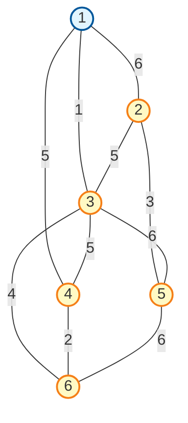
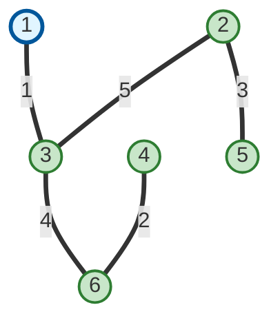

# 最小生成树

## 基本概念

> **最小生成树（Minimum Spanning Tree, MST）**：带权连通无向图中，所有生成树中权值之和最小的生成树

**关键特点：**
- 包含图中所有顶点
- 无回路（n个顶点有n-1条边）
- 边的权值之和最小

---

## 示例图

### 原图（带权无向图）



**边权值列表：**

| 边 | 权值 | 边 | 权值 |
|:---:|:----:|:---:|:----:|
| 1-2 | 6 | 2-5 | 3 |
| 1-3 | 1 | 3-4 | 5 |
| 1-4 | 5 | 3-5 | 6 |
| 2-3 | 5 | 3-6 | 4 |
| 2-5 | 3 | 4-6 | 2 |
| 5-6 | 6 | | |

---

### 最小生成树（Prim算法结果）



**最小生成树的边：**

| 边 | 权值 | 说明 |
|:---:|:----:|:----:|
| 1-3 | 1 | 连接顶点1和3 |
| 2-3 | 5 | 连接顶点2和3 |
| 2-5 | 3 | 连接顶点2和5 |
| 3-6 | 4 | 连接顶点3和6 |
| 4-6 | 2 | 连接顶点4和6 |

**总权值：** 1 + 5 + 3 + 4 + 2 = **15**

---

## Prim算法（普里姆算法）

### 算法思想

**从一个顶点开始，逐步扩展顶点集合，每次选择距离当前集合最近的顶点**

> 类似：修路时，从已建好的区域向外延伸，每次选择最近的未连通区域

### 算法步骤

**步骤1：** 任取一个顶点，去掉所有边

```
选择顶点1作为起点
当前顶点集合：{1}
```

**步骤2：** 选择与当前顶点集合距离最近的顶点，将该顶点和相应的边加入进来，同时不能形成回路

```
第1轮：选择 1-3（权1），加入顶点3
当前顶点集合：{1, 3}
已选边：{1-3}

第2轮：选择 4-6（权2），加入顶点6
当前顶点集合：{1, 3, 6}
已选边：{1-3, 4-6}

第3轮：选择 2-5（权3），加入顶点5
当前顶点集合：{1, 3, 5, 6}
已选边：{1-3, 4-6, 2-5}

第4轮：选择 3-6（权4），顶点6已选
         选择 2-3（权5），加入顶点2
当前顶点集合：{1, 2, 3, 5, 6}
已选边：{1-3, 4-6, 2-5, 2-3}
```

**步骤3：** 重复步骤2，直至图中所有顶点都并入

```
第5轮：选择 4-6（权2），加入顶点4
当前顶点集合：{1, 2, 3, 4, 5, 6}
已选边：{1-3, 4-6, 2-5, 2-3, 4-6}
完成！
```

### 算法特点

| 特点 | 说明 |
|:----:|:----:|
| **起始点** | 可任选一个顶点 |
| **选择策略** | 每次选择最近的顶点 |
| **避免回路** | 已访问的顶点不再加入 |
| **时间复杂度** | O(n²）或 O(m log n) |

### 适用场景

- **网络布线**：用最少的线缆连接所有节点
- **道路规划**：用最短路径连接所有城市
- **电路设计**：最小化线路成本

---

## Prim算法 vs Kruskal算法

| 特性 | Prim算法 | Kruskal算法 |
|:----:|:--------:|:-----------:|
| **策略** | 顶点优先 | 边优先 |
| **数据结构** | 优先队列 | 并查集 |
| **适用场景** | 稠密图 | 稀疏图 |
| **实现难度** | 较简单 | 较复杂 |

> **选择建议：**
> - 顶点多、边多（稠密图）→ 用Prim
> - 边少（稀疏图）→ 用Kruskal

---
**版权所属：米醋电子工作室 | KimJong**