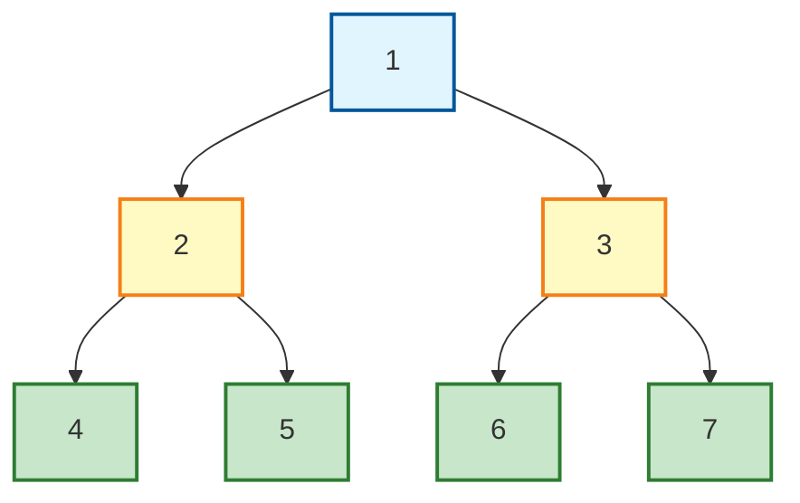
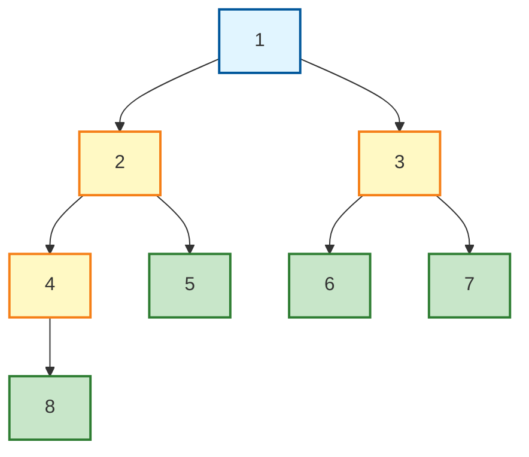
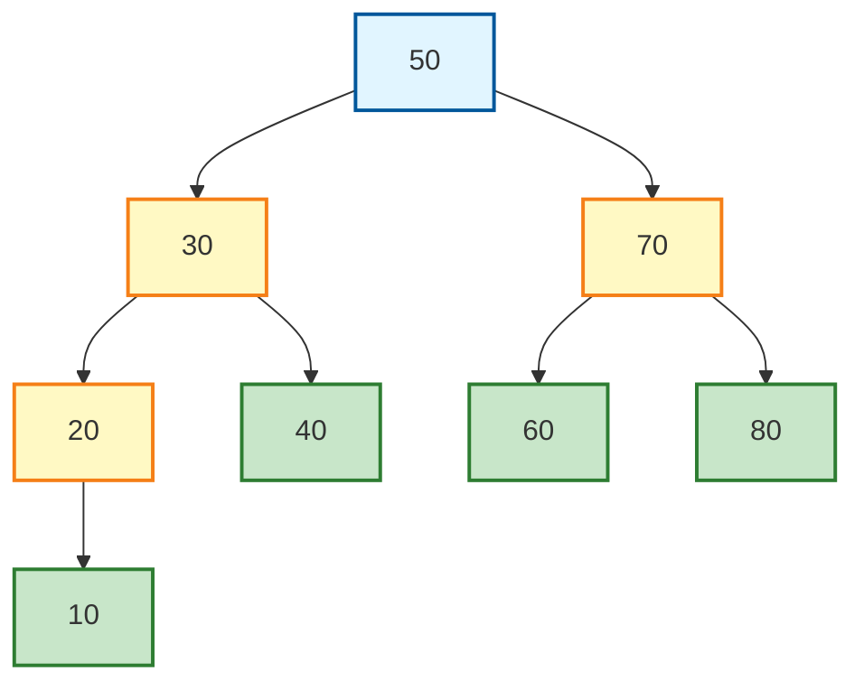
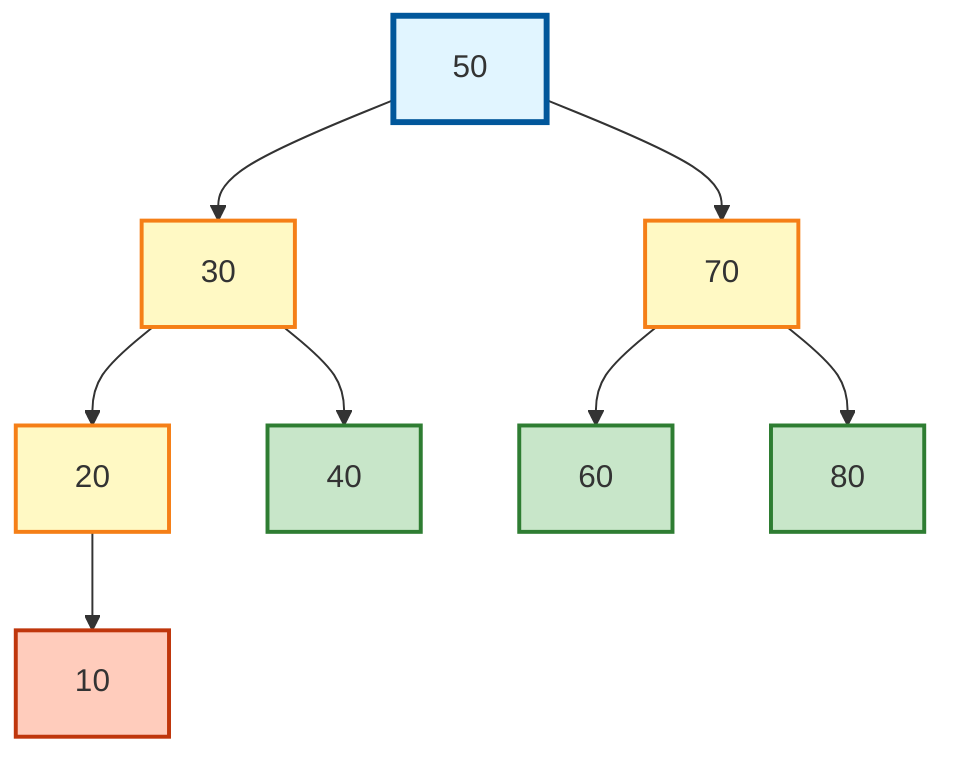
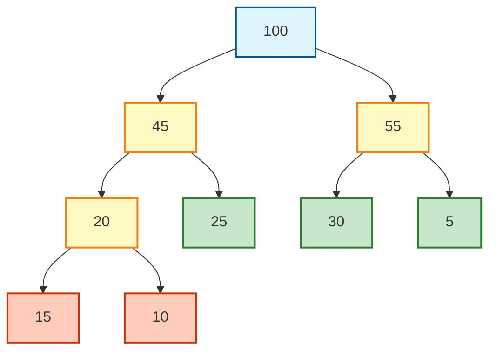
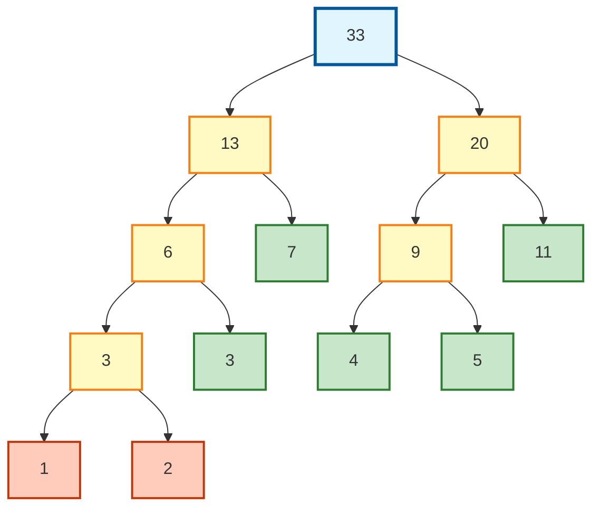

# 二叉树

## 满二叉树



> **满二叉树特点：**
> - 所有层（除叶子层外）的节点都有 2 个子节点
> - 叶子节点全部在最底层
> - 第 i 层有 2^(i-1) 个节点
> - 高度为 h 的满二叉树共有 2^h - 1 个节点

---

## 完全二叉树



> **完全二叉树特点：**
> - 除了最后一层外，其他层都是满的
> - 最后一层的节点尽可能靠左排列
> - 完全二叉树从左到右依次填充，不能有 "空缺"
> - 满二叉树一定是完全二叉树，但完全二叉树不一定是满二叉树

---

## 二叉排序树（BST）



> **二叉排序树特点：**
> - **左子树** 上所有节点的值 **< 根节点** 的值
> - **右子树** 上所有节点的值 **> 根节点** 的值
> - 左、右子树也分别为二叉排序树
> - 中序遍历二叉排序树可以得到 **有序序列**（从小到大）

> **示例说明：**
> - 根节点 50，左子树所有值(10,20,30,40)都小于 50
> - 右子树所有值(60,70,80)都大于 50
> - 节点 30 的左子树(10,20)小于 30，右子树(40)大于 30

---

## 二叉树的遍历

> **遍历方式：**
> - **N** = 根节点
> - **L** = 左子树
> - **R** = 右子树

### 示例树结构

使用上面的二叉排序树作为示例：



---

### 1. 先序遍历（Preorder - NLR）

**遍历顺序：根 → 左 → 右**

**遍历过程：**
```
50 → 访问左子树30 → 访问左子树20 → 访问左子树10 → 访问右子树40 → 访问右子树70 → 访问左子树60 → 访问右子树80
```

**遍历结果：** **50, 30, 20, 10, 40, 70, 60, 80**

> **应用场景：**
> - 复制树结构
> - 获取树的目录结构（前缀表达式）

---

### 2. 中序遍历（Inorder - LNR）

**遍历顺序：左 → 根 → 右**

**遍历过程：**
```
访问左子树10 → 20 → 访问右子树(无) → 30 → 访问左子树(无) → 40 → 50 → 访问左子树60 → 70 → 访问右子树80
```

**遍历结果：** **10, 20, 30, 40, 50, 60, 70, 80**

> **应用场景：**
> - **二叉排序树的中序遍历是有序序列**
> - 获取有序数据

---

### 3. 后序遍历（Postorder - LRN）

**遍历顺序：左 → 右 → 根**

**遍历过程：**
```
访问左子树10 → 20 → 访问右子树40 → 30 → 访问左子树60 → 访问右子树80 → 70 → 50
```

**遍历结果：** **10, 20, 40, 30, 60, 80, 70, 50**

> **应用场景：**
> - 删除树结构（先删除子树，再删除根）
> - 计算表达式（后缀表达式）
> - 释放内存空间

---

### 遍历总结对比

| 遍历方式 | 顺序 | 记忆口诀 | 结果 | 应用 |
|:--------:|:----:|:--------:|:----:|:----:|
| **先序** | 根左右 | NLR | 50,30,20,10,40,70,60,80 | 复制树、前缀表达式 |
| **中序** | 左根右 | LNR | 10,20,30,40,50,60,70,80 | BST 排序、中缀表达式 |
| **后序** | 左右根 | LRN | 10,20,40,30,60,80,70,50 | 删除树、后缀表达式 |

> **记忆技巧：**
> - 先序：先访问根，再左右
> - 中序：根在中间访问
> - 后序：最后访问根

---

## 哈夫曼树（最优二叉树）



> **哈夫曼树特点：**
> - 带权路径长度（WPL）**最小** 的二叉树
> - 权值越大的叶子离根越近，权值越小的叶子离根越远
> - 没有度为 1 的节点（只有度为 0 或 2 的节点）
> - 构造方式：每次选择权值最小的两个节点合并

---

## 带权路径长度（WPL）计算

### 定义

> **WPL = Σ(叶子节点的权值 × 该叶子到根节点的路径长度)**

路径长度 = 从根到该叶子经过的边数

### 示例计算

以上图哈夫曼树为例：

| 叶子节点 | 权值 w | 路径长度 l | w × l |
|:--------:|:------:|:----------:|:-----:|
| **5** | 5 | 3 | 5 × 3 = 15 |
| **10** | 10 | 3 | 10 × 3 = 30 |
| **15** | 15 | 3 | 15 × 3 = 45 |
| **25** | 25 | 2 | 25 × 2 = 50 |
| **30** | 30 | 2 | 30 × 2 = 60 |

**WPL = 15 + 30 + 45 + 50 + 60 = 200**

---

### 构造过程示例

给定权值序列：**{5, 10, 15, 25, 30}**

**步骤 1：** 选择最小的 5 和 10，合并成新节点 15
```
{15, 15, 25, 30}
```

**步骤 2：** 选择最小的 15 和 15，合并成新节点 30
```
{25, 30, 30}
```

**步骤 3：** 选择最小的 25 和 30，合并成新节点 55
```
{30, 55}
```

**步骤 4：** 选择最小的 30 和 55，合并成根节点 100
```
{100} ✓
```

---

### WPL 的意义

- **编码效率**：哈夫曼编码用于数据压缩，WPL 越小，编码效率越高
- **最优性**：哈夫曼树是 WPL 最小的二叉树
- **应用**：文件压缩、通信编码、决策树优化等

---

## 练习题

**题目：** 给定字符集及其出现次数：

| 字符 | A | B | C | D | E | F | G |
|:----:|:-:|:-:|:-:|:-:|:-:|:-:|:-:|
| 权值 | 7 | 3 | 2 | 5 | 11 | 1 | 4 |

要求：
1. 构造哈夫曼树
2. 给出哈夫曼编码
3. 计算带权路径长度 WPL

---

### 答案

#### (1) 哈夫曼树构造过程

```
初始序列：{7, 3, 2, 5, 11, 1, 4}

步骤1：选 1+2=3        {3, 3, 4, 5, 7, 11}
步骤2：选 3+3=6        {4, 5, 6, 7, 11}
步骤3：选 4+5=9        {6, 7, 9, 11}
步骤4：选 6+7=13       {9, 11, 13}
步骤5：选 9+11=20      {13, 20}
步骤6：选 13+20=33     {33} ✓
```



---

#### (2) 哈夫曼编码

| 字符 | 权值 | 路径 | 编码 |
|:----:|:----:|:----:|:----:|
| E | 11 | 右 | **00** |
| A | 7 | 左右 | **01** |
| D | 5 | 右左右 | **100** |
| G | 4 | 右右左 | **1010** |
| B | 3 | 左左右 | **1011** |
| C | 2 | 左左左右 | **1100** |
| F | 1 | 左左右左 | **11010** |

> **编码规则：** 左分支为 0，右分支为 1

---

#### (3) WPL 计算

| 字符 | 权值 w | 路径长度 l | w × l |
|:----:|:------:|:----------:|:-----:|
| E | 11 | 2 | 22 |
| A | 7 | 2 | 14 |
| D | 5 | 3 | 15 |
| G | 4 | 4 | 16 |
| B | 3 | 4 | 12 |
| C | 2 | 4 | 8 |
| F | 1 | 5 | 5 |

**WPL = 22 + 14 + 15 + 16 + 12 + 8 + 5 = 92**

---

### 答案总结

✅ **WPL = 92**

**验证：** 所有叶子节点权值之和 = 7+3+2+5+11+1+4 = 33（根节点）