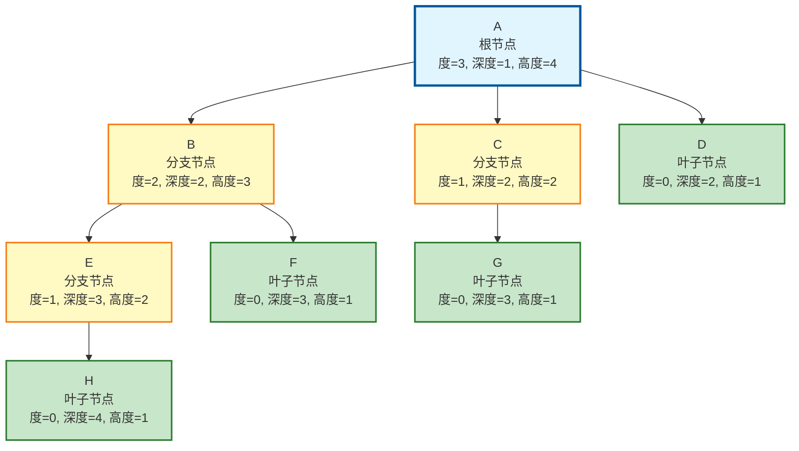

# 树的基本术语

## 树结构示意图与术语标注



> **图例说明：**
> - 🔵 **蓝色** - 根节点
> - 🟡 **黄色** - 分支节点（非终端节点）
> - 🟢 **绿色** - 叶子节点（终端节点）

---

## 基本术语详解

### （1）祖先、双亲、孩子

| 术语 | 定义 | 示例 |
|------|------|------|
| **祖先** | 从根到该节点所经分支上的所有节点 | A、B是E的祖先；A是所有节点的祖先 |
| **双亲（父节点）** | 若一个节点有子树，则该节点称为子树根的双亲 | B是E、F的双亲；A是B、C、D的双亲 |
| **孩子（子节点）** | 若节点A是节点B的双亲，则B称为A的孩子 | E、F是B的孩子；B、C、D是A的孩子 |

### （2）结点的度、树的度

| 术语 | 定义 | 示例 |
|------|------|------|
| **结点的度** | 节点拥有的子树个数（即孩子数量） | A的度=3, B的度=2, D的度=0 |
| **树的度** | 树内各节点度的最大值 | 此树的度 = max(3,2,1,0) = 3 |

### （3）分支结点、叶子结点、兄弟

| 术语 | 定义 | 示例 |
|------|------|------|
| **分支结点（非终端结点）** | 度大于0的节点 | A、B、C、E是分支节点 |
| **叶子结点（终端结点）** | 度为0的节点 | D、F、G、H是叶子节点 |
| **兄弟** | 同一双亲的孩子 | E和F是兄弟；B、C、D是兄弟 |

### （4）深度、高度

| 术语 | 定义 | 示例 |
|------|------|------|
| **深度（层次）** | 从根节点到该节点的路径长度（根节点深度为1） | A深度=1, B深度=2, E深度=3, H深度=4 |
| **高度** | 从该节点到叶子节点的最长路径 | A高度=4, B高度=3, D高度=1, H高度=1 |

> **注意**：树的深度 = 树的高度（从根到最远叶子节点的路径长度）
> 本例中：树的深度 = 树的高度 = 4

### （5）有序树、无序树

| 术语 | 定义 |
|------|------|
| **有序树** | 节点子树有顺序关系，不能交换位置 |
| **无序树** | 节点子树无顺序关系，可以任意交换位置 |

### （6）路径、路径长度

| 术语 | 定义 | 示例 |
|------|------|------|
| **路径** | 树中两个节点之间所经过的节点序列 | A→B→E→H 是一条路径 |
| **路径长度** | 路径上的边数（节点数-1） | A→B→E→H 的路径长度 = 3 |

---

## 快速查找表

| 节点 | 度 | 深度 | 高度 | 类型 | 双亲 | 孩子 |
|:----:|:--:|:----:|:----:|:----:|:----:|:----:|
| A | 3 | 1 | 4 | 根、分支 | - | B,C,D |
| B | 2 | 2 | 3 | 分支 | A | E,F |
| C | 1 | 2 | 2 | 分支 | A | G |
| D | 0 | 2 | 1 | 叶子 | A | - |
| E | 1 | 3 | 2 | 分支 | B | H |
| F | 0 | 3 | 1 | 叶子 | B | - |
| G | 0 | 3 | 1 | 叶子 | C | - |
| H | 0 | 4 | 1 | 叶子 | E | - |

---

## 树的性质

### （1）节点数与度数的关系

> **性质：树中的节点数等于所有节点的度数之和加1**

**推导说明：**
- 树是**无环连通图**
- 除根节点外，每个节点有且仅有一个父节点
- 所有节点的度数之和 = 子节点数量
- **总结点数 = 根节点(1个) + 子节点数量(度数之和)**

**验证示例：**
```
度数之和 = 3(A) + 2(B) + 1(C) + 0(D) + 1(E) + 0(F) + 0(G) + 0(H) = 7
节点数 = 7 + 1 = 8 ✓
```

---

### （2）m叉树第i层的节点数上限

> **性质：度为m的树中，第i层上至多有 m^(i-1) 个节点**

| 第i层 | 1 | 2 | 3 | ... | i |
|:-----:|:-:|:-:|:-:|:---:|:-:|
| 节点数 | 1 | m | m² | ... | m^(i-1) |

**推导说明：**
- 第1层（根节点层）：固定为 1 个节点 (m⁰ = 1)
- 第2层（根的子节点层）：最多有 m 个节点
- 第3层（子节点的子节点层）：最多有 m × m = m² 个节点
- 依此类推，第i层最多有 m^(i-1) 个节点

**示例（m=3的三叉树）：**
```
第1层：1个节点
第2层：最多3个节点
第3层：最多9个节点
第4层：最多27个节点
```

---

### （3）高度为h的m叉树的最大节点数

> **性质：高度为h的m叉树至多有 (m^h - 1)/(m - 1) 个节点**

**数学推导：**

等比数列求和：
```
S = 1 + m + m² + ... + m^(h-1)
```

等比数列求和公式：
```
S = a₁(rⁿ - 1)/(r - 1)
```

其中：
- 首项 a₁ = 1
- 公比 r = m
- 项数 n = h

代入得：
```
最大节点数 = (m^h - 1)/(m - 1)
```

**示例验证：**

| 树的类型 | m | h | 最大节点数 | 计算 |
|:--------:|:-:|:-:|:----------:|:----:|
| 二叉树 | 2 | 3 | 7 | (2³-1)/(2-1) = 7 |
| 三叉树 | 3 | 2 | 4 | (3²-1)/(3-1) = 4 |
| 三叉树 | 3 | 3 | 13 | (3³-1)/(3-1) = 13 |

---

### （4）n个节点的m叉树的最小高度

> **性质：具有n个节点的m叉树的最小高度为 ⌈logₘ(n(m-1) + 1)⌉**

**推导说明：**

1. 最小高度对应**满m叉树**（每层节点数达到上限）

2. 满m叉树的高度h与节点数n的关系：
```
n ≤ (m^h - 1)/(m - 1)
```

3. 解不等式：
```
n(m - 1) ≤ m^h - 1
m^h ≥ n(m - 1) + 1
```

4. 两边取对数（以m为底）：
```
h ≥ logₘ(n(m - 1) + 1)
```

5. 由于高度h为整数，需向上取整：
```
最小高度 = ⌈logₘ(n(m - 1) + 1)⌉
```

> **符号说明：** ⌈x⌉ 表示对x向上取整（不小于x的最小整数）

**示例计算：**

| 节点数n | m | 最小高度计算 | 结果 |
|:-------:|:-:|:------------:|:----:|
| 7 | 2 | ⌈log₂(7×1+1)⌉ = ⌈3⌉ | 3 |
| 15 | 2 | ⌈log₂(15×1+1)⌉ = ⌈4⌉ | 4 |
| 13 | 3 | ⌈log₃(13×2+1)⌉ = ⌈log₃27⌉ = ⌈3⌉ | 3 |

---

## 补充说明

- **树的节点数** = 所有节点的度之和 + 1（根节点）
  - 验证：(3+2+1+1) + 1 = 8 ✓

- **树的节点数** = 度为0的节点数 + 度>0的节点数
  - 叶子节点数 = 4 (D,F,G,H)
  - 分支节点数 = 4 (A,B,C,E)

- **森林**：m棵互不相交的树的集合


